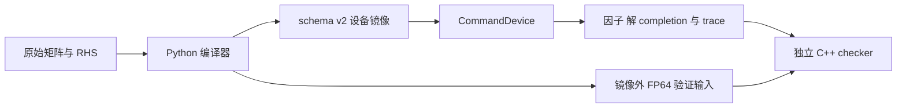
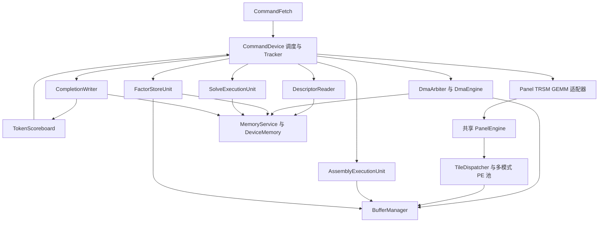

# 项目总体架构设计

实现基准：2026-10-11 当前工作区。本文定义系统组成、模块职责、数据流和执行关系。
软件实现见 [软件侧技术文档](../software/软件侧技术文档.md)，设备建模方式见
[SystemC 模型规范](../systemc/SystemC模型规范.md)，二进制接口见
[Command Schema v2](../interface/Command_Schema_v2.md)。

## 1. 系统组成

系统求解实数稀疏方阵对应的线性方程 `Ax=b`。软件对预处理后的矩阵 B 使用
`pattern(B) ∪ pattern(Bᵀ)` 构造保守的对称结构包络，再将多前沿 LU 的节点工作
编译为设备命令。数值矩阵本身可以非对称；结构包络不改变输入数值，不构造正规方程。
数学依据见 [矩阵求解理论基础](../theory/矩阵求解理论基础.md)。



| 组成 | 输入 | 输出 | 实现入口 |
|---|---|---|---|
| 软件编译器 | 矩阵、RHS、结构/数值/资源配置 | manifest、命令与数据镜像、验证辅助文件 | [pipeline.py](../../graduation-code/software/src/pipeline.py) |
| 设备执行器 | manifest、FP32 设备镜像、运行配置 | 执行后镜像、completion、统计与事务记录 | [tree_factor_device.cpp](../../graduation-code/systemc/src/tree_factor_device.cpp) |
| 独立参考与验收 | 初始输入、设备因子/解、执行报告 | 因子和三角求解验收、原方程误差 | [reference/](../../graduation-code/systemc/reference/) |

编译器决定排序、节点、映射与依赖；设备不重新做符号分析。
设备从自己的内存计算数值，FP64 参考文件由外部验证程序读取。

## 2. 软件与设备之间的数据契约

软件先对 `A/b` 做一致的行均衡、行匹配和变量排序，形成 `A_hat/b_hat`。
变换和最终解恢复见 [软件侧技术文档 §3.2](../software/软件侧技术文档.md#32-坐标变换与置换约定)。

编译产物使用小端 schema v2：Command 32 字节，Descriptor 64 字节，Completion 64 字节。
命令中的 descriptor 引用为记录 ID；区域基址为相对镜像起点的字节偏移。
命令 wait token 显式表达依赖，设备不从 host 树对象补推依赖。

manifest 保存加载配置、区域、节点和编译约定。运行时取指、descriptor 解析和数据访问仍通过
设备事务进行；加载时的格式检查不能替代运行时访问。设备 front、因子、RHS 和解采用 FP32，
P-vector 与变量索引采用整数格式。

## 3. 设备子系统与连接关系



| 子系统 | 职责 | 模块文档 |
|---|---|---|
| 控制面 | 取指、依赖、节点准入、资源分配、完成、失败和取消 | [控制面设计](../systemc/控制面设计.md) |
| 数据面 | 镜像加载、区域权限、DDR 事务、描述符、scratch 槽、lease 和 DMA | [数据面设计](../systemc/数据面设计.md) |
| 共享计算引擎 | 计算组、controller 上下文、tile 队列/版本、PE 和带宽仲裁 | [共享计算引擎与 PE 设计](../systemc/共享计算引擎与PE设计.md) |
| Panel-LU | 全 front 尺度扫描、A11 的分块固定顺序分解 | [Panel-LU 模块设计](../systemc/Panel-LU模块设计.md) |
| TRSM | 从 packed A11 求 U12 和 L21 | [TRSM 模块设计](../systemc/TRSM模块设计.md) |
| Schur GEMM | 更新 A22，可选择局部 INT32 转换与计算 | [GEMM/局部 INT32 设计](../systemc/GEMM_Schur与局部INT32设计.md) |
| 装配与因子保存 | child update 累加、packed front 转换为持久 L/U | [装配与因子保存设计](../systemc/装配与因子保存设计.md) |
| 树形求解 | 从持久因子前代/回代，写中间量和最终解 | [树形求解模块设计](../systemc/树形求解模块设计.md) |
| HPU/ATU 独立模块 | 整数候选归约、逻辑行到物理行映射 | [HPU/ATU 模块设计](../systemc/HPU_ATU模块设计.md) |

`CommandDevice` 内部承担调度器和 front 管理职责，没有独立的 GCU、Scheduler 或
FrontManager C++ 类。`PanelEngine` 虽沿用 Panel 名称，实际服务 Panel、TRSM、GEMM 三类计算。
装配和树形求解使用各自的独立通路；求解未接入 tile PE 池。

### 3.1 RTL 原型的实际连接

RTL 目录目前独立于上述 CommandDevice。HPU/ATU 保存候选归约与行映射原型，
接口和状态见其模块文档。[GCU 顶层](../../graduation-code/hardware/GCU/gcu_top.sv)
只有时钟/复位端口；[取指模块](../../graduation-code/hardware/GCU/gcu_task_fetch.sv)
默认消费 128 bit 的旧 task，[类型包](../../graduation-code/hardware/GCU/include/gcu_types_pkg.sv)
使用旧 NodeTask 字段。它们没有连接当前 schema v2 Command/Descriptor/Completion。
RTL 的 child 计数和 buffer 状态不能等同于当前 token/lease 协议。

局部 INT32 转换实际位于 SystemC precision_adapter；QAU 目录没有对应 RTL 实现，
Matrix_Engine 也没有现存 GEMM RTL。源码组织见 [硬件目录说明](../../graduation-code/hardware/README.md)。

## 4. 存储层次与数据生命周期

| 层次 | 保存内容 | 生命周期与访问 |
|---|---|---|
| 设备 DDR 镜像 | 命令、描述符、局部贡献、持久 L/U/P/update、RHS、workspace 和解 | 静态区域跨节点保留；运行时经 MemoryService |
| front scratch | 当前节点装配后的 front 与数值更新 | NODE_BEGIN 分配，节点收尾且访问排空后复用 |
| temp scratch | child update 搬运等临时数据 | 随驻留节点保留，由 DMA 和装配使用 |
| solve scratch | 求解行缓冲与局部向量的容量预留 | 按求解命令申请与释放 |
| PE 本地存储 | 有限 tile 操作数、累加/结果、task slot | 按内部任务使用，不保存完整 host front |

默认最多两个驻留 front，每个持有 front/temp 两槽，加一个求解暂存槽，共五槽。
槽内授权由 handle、generation、owner 与 lease 表达；片上带宽另由 `OnChipArbiter` 控制。
DDR 是单端口 FIFO 服务，DMA 同时只有一个活动传输，多客户端在这些共享资源上排队。

child commit 后其 scratch 可回收；DDR update 仍保留，供 parent 随后装配。
L/U/P 在节点分解后保存，求解只读取这些因子。RHS 只读，`solution_data` 从零累加器
逐步转为中间量和最终 `x_hat`。reset 使旧事务/句柄失效，不撤销已完成的 DDR 写入。

## 5. 分解执行流程

节点 front 按 pivot/update 分块，记维度 `n/p/u`，`u=n-p`：

```text
F = [ A11(p×p)  A12(p×u) ]
    [ A21(u×p)  A22(u×u) ]

NODE_BEGIN → LOAD_FRONT → 逐 child ASSEMBLE_EXTEND_ADD → PANEL_LU
PANEL_LU → TRSM_LEFT  → U12
PANEL_LU → TRSM_RIGHT → L21
两条 TRSM → GEMM_SCHUR → STORE_UPDATE
两条 TRSM → STORE_FACTOR
STORE_FACTOR + STORE_UPDATE → NODE_COMMIT
```

Panel 只分解 A11；左右 TRSM 分别作用于 A12/A21；GEMM 只更新 A22。
`u=0` 时省略两条 TRSM、GEMM 和 update 保存。没有 child 的节点省略装配。
父节点 begin 等待全部 child commit；同 parent 的装配串行累加。

软件最多交错两个节点的命令计划。设备在 token 满足且资源可原子获取时派发，
同 front 的冲突命令保守串行；不同 front 可在计算、DMA 和收尾阶段重叠。
计算结束、数据写入、completion 写确认和 token READY 是不同事件，后继依赖最后一个事件。

## 6. 求解执行流程

完整批次在分解命令之后追加子先父后的前代链和相反顺序的回代链。
每条求解命令等待本节点 commit 和上一条求解命令，wait list 最多两个 token。
控制面在全部 commit 到达终态前，将提前取出的求解命令设为 parked，避免占满调度窗口。

前代使用局部 P-vector gather RHS，解 L11，向 update 变量累加 `-L21*z`，保存 `z`。
回代读取已求出的祖先变量，减去 U12 的贡献并解 U11。所有回代结束后，host 恢复原变量顺序。
串行链保证全局累加器的读改写顺序；当前入口处理单 RHS。
求解算术成本当前进入统计及响应时间戳，尚未驱动状态机等待；完整时序限制见求解模块 §4.2。

## 7. 计算资源与数值模式

默认正式入口配置两个计算组，每组两个 16×16 `MultiModePe`。
计算命令独占一个组，组内不同 tile 可以并行；组不永久绑定节点或计算类型。
适配器实例数、计算组数、每组 PE 数是不同参数。

正式设备后端为 `FP32_SYSTEMC` 或 `FP32_SYSTEMC_INT32_GEMM`。
后者只改变顶层 GEMM 的 tile 运算，Panel、TRSM、内部 GEMM 更新和树形求解仍为 FP32。
INT32 scale 不传播到父 front 或整个消除树。FP64 模块诊断需要显式配置，独立 FP64 checker
在设备外运行，二者均不构成自动精度回退。

正式 Panel 当前接受 STATIC，遇到 DYNAMIC_PANEL 显式拒绝。
HPU/ATU 的独立整数接口尚不能直接服务 FP32 主元搜索；相关实际事务见模块文档。

## 8. 启动、输出与错误处理

`tree_factor_device` 校验后端一致性，按 manifest 的槽容量和 front 上限配置设备，
加载 artifact，再通过 `start/tick/run` 执行。仅分解与分解加求解两种 scope 使用同一入口。
默认周期保护上限为 40,000,000，可用 `--max-cycles` 指定正整数；超时结束为 batch fault。

执行结果包含最终镜像、逐命令状态/周期/流量、节点和资源占用、访存及 buffer 生命周期记录。
具体字段见控制面与模型规范。非法访问、描述符错误、数值失败和依赖失败各自保持明确状态；
定向取消等待在途工作安全收尾，reset 用 epoch/generation 隔离旧工作。

设备报告区分控制流完成和数值命令状态。因子误差、前代/回代后向误差、原方程后向误差及解误差
由独立 checker 计算。输入病态时，三角求解后向误差小也可能伴随较大解误差，
解释依据见 [数值误差理论](../theory/数值误差分析理论基础.md)。
