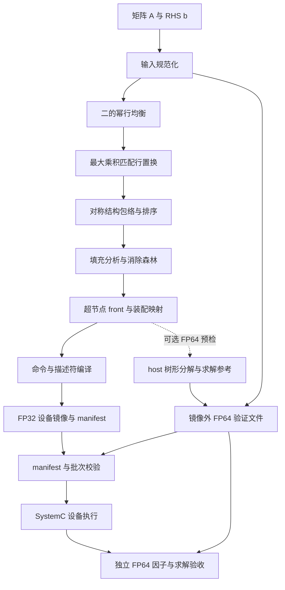

# 软件侧技术文档

| 项目 | 说明 |
|---|---|
| 系统 | 多前沿稀疏 LU 求解器的软件编译与验证工具 |
| 文档基准 | 2026-10-11 当前工作区实现 |
| 适用接口 | Command / Descriptor / Completion schema v2 |
| 代码位置 | `graduation-code/software/` |
| 读者 | 软件开发、设备接口开发、测试与维护人员 |
| 范围 | 输入处理、预处理、符号结构、命令编译、设备镜像、host 参考与产物校验 |

本文是软件侧的统一实现说明。数学推导见 [矩阵求解理论基础](../theory/矩阵求解理论基础.md)
和 [数值误差分析理论基础](../theory/数值误差分析理论基础.md)；二进制字段定义以
[Command Schema v2](../interface/Command_Schema_v2.md) 为准。
项目完成情况见 [当前进度](../../当前进度.md)，未完成工作见 [todo](../../todo.md)。

阅读导航：[系统职责](#1-系统职责与约束) · [架构与代码入口](#2-软件架构与代码入口) ·
[数据契约](#3-输入与中间数据契约) · [处理阶段](#4-编译前处理) ·
[命令与镜像](#5-命令编译与设备接口) · [参考与验证](#6-host-参考与数值验证) ·
[配置](#7-配置与命令行接口) · [输出](#8-输出产物与-manifest) ·
[运行与诊断](#9-运行与故障诊断) · [测试与维护](#10-测试与维护要求)。

## 1. 系统职责与约束

软件把实数稀疏方阵 `A` 和右端向量 `b` 编译为设备可消费的静态命令批次。
默认批次包含分解、树形前代和回代；`--factorization-only` 可生成仅分解批次。
执行模型见 [SystemC 模型规范](../systemc/SystemC模型规范.md)。

软件负责确定坐标变换、消除森林、节点 front、装配映射、依赖关系及 DDR 布局，
并生成 `manifest.json` 和 `memory_image.bin`。Panel-LU、TRSM、GEMM 和设备三角求解
由设备模型执行。可选 host FP64 参考用于预检和验收，其结果不得注入设备执行路径。

必须保持以下契约：

- 设备数据为 FP32；索引与置换为 INT32/UINT32。FP64 参考文件位于镜像外。
- Command、Descriptor、Completion 分别为 32、64、64 字节；采用小端编码和字节偏移地址。
- 置换统一采用 gather 约定；矩阵、RHS、因子、解的坐标空间必须一致。
- 不做全局 BFP 或全局量化。可选 INT32 只作用于单次顶层 `GEMM_SCHUR` 调用。
- 主元失败必须显式报告；不静默替换零主元、小主元或非有限数。
- 格式校验成功、命令 `status=OK`、数值验收通过分别表达不同结论。

当前软件可编译 `STATIC` 和 `DYNAMIC_PANEL` 策略，也有相应 FP64 参考。
正式设备路径目前只支持 `STATIC`；动态策略会返回 `POLICY_NOT_SUPPORTED`。
manifest 的能力声明描述目标设备需要具备的能力，不能作为当前设备已实现该能力的证明。

## 2. 软件架构与代码入口



CLI 调用 `run_pipeline()` 完成完整流水线。各模块通过显式数据对象传递结果，
命令编译器仅消费规范化的节点、局部 front、映射和向量，不重新执行符号分析。

| 层次 | 代码入口 | 职责与输出 |
|---|---|---|
| 命令行与配置 | [main.py](../../graduation-code/software/src/main.py)、[config.py](../../graduation-code/software/src/config.py) | 参数解析、配置校验、成功摘要与退出码 |
| 流水线 | [pipeline.py](../../graduation-code/software/src/pipeline.py) | 串联处理阶段、组织参考文件、补充 manifest 并校验 |
| 输入 | [matrix_io.py](../../graduation-code/software/src/matrix_io.py) | 方阵与 RHS 读取、随机输入生成 |
| 行均衡 | [equilibration.py](../../graduation-code/software/src/equilibration.py) | 缩放矩阵与 RHS，记录每行指数 |
| 行匹配 | [matching.py](../../graduation-code/software/src/matching.py) | CSR 规范化、稀疏加权匹配与 gather 行置换 |
| 结构分析 | [pattern.py](../../graduation-code/software/src/symbolic/pattern.py)、[ordering.py](../../graduation-code/software/src/symbolic/ordering.py)、[fill.py](../../graduation-code/software/src/symbolic/fill.py)、[supernode.py](../../graduation-code/software/src/symbolic/supernode.py) | 结构包络、排序、填充、父关系、超节点与 front 索引 |
| 树与映射 | [task_queue.py](../../graduation-code/software/src/scheduler/task_queue.py)、[map_gen.py](../../graduation-code/software/src/scheduler/map_gen.py) | 子先父后的拓扑序、child update 到 parent front 的位置映射 |
| 编译与布局 | [command_compiler.py](../../graduation-code/software/src/scheduler/command_compiler.py)、[planner.py](../../graduation-code/software/src/memory/planner.py) | 命令计划、依赖、描述符、区域布局与镜像 |
| 编解码 | [command_codec.py](../../graduation-code/software/src/command_codec.py) | schema v2 枚举、记录、payload、批次合法性与二进制编解码 |
| 数据与写出 | [dataStruct.py](../../graduation-code/software/src/dataStruct.py)、[io.py](../../graduation-code/software/src/io.py) | 编译中间对象、严格 JSON 写出 |
| host 数值参考 | [front_reference.py](../../graduation-code/software/src/verify/front_reference.py)、[metrics.py](../../graduation-code/software/src/verify/metrics.py) | FP64 树形分解/求解、失败分类与误差指标 |
| 产物复核 | [manifest.py](../../graduation-code/software/src/verify/manifest.py) | 从落盘产物复核 ABI、布局、依赖、映射、求解契约及参考文件 |

开发阅读顺序建议为 `main.py → config.py → pipeline.py → dataStruct.py → command_compiler.py`，
再按所负责阶段进入处理模块、codec 和校验器。

## 3. 输入与中间数据契约

### 3.1 输入矩阵与右端向量

设原方程维度为 `N`。预期输入为非空、有限实数方阵和长度为 `N` 的向量。
host 处理采用 FP64；设备初始 front 和 RHS 在生成镜像时转换为 FP32。

| 输入 | 当前行为 |
|---|---|
| 未传 `--mtx` | 按 `n/density/seed` 生成对称随机矩阵并加 `N·I`，用于默认可复现实验 |
| `.mat` 矩阵 | 使用 `scipy.io.loadmat`；选择第一个非元数据的二维稠密或稀疏矩阵 |
| 其他矩阵文件 | 使用 `scipy.io.mmread`，用于 Matrix Market 输入 |
| 未传 `--rhs` | 按 `rhs_seed` 生成 `x_true`，计算原坐标 `b=A*x_true` |
| `.mat` RHS | 选择非元数据数组并展平，检查长度和有限性 |
| `.npy` RHS | 使用 `numpy.load`，转换为 FP64 并展平 |

包含多个数组的 `.mat` 文件可能选中非预期对象；CLI 没有数组 key 选择参数。
应准备内容明确的输入文件，并核对维度与来源。复数输入不属于本接口的支持范围。

矩阵统一转换为 CSR：合并重复项、检查合并后有限性、去除显式零、按列索引排序。
该规范化发生在结构分析和匹配之前，以免重复项或存储零改变结构判断。

外部 RHS 默认没有已知解。开启 `--reference-check` 时，软件另用稀疏 FP64 求解器
计算原方程参考解；非有限结果会导致编译失败。生成 RHS 时的 `x_true` 与稀疏求解所得
参考解的来源不同，必须根据 `verification.rhs_source` 和相应文件字段解读。

### 3.2 坐标变换与置换约定

所有置换数组 `p` 表示 gather：`y[i] = x[p[i]]`。
`row_perm_match` 表示匹配后的行到原输入行的映射，`ordering_perm`（下记 `q`）
表示排序后的变量到匹配矩阵变量的映射。统一变换为：

```text
A_eq  = D_r A                 b_eq  = D_r b
B     = P_match A_eq          b_m   = P_match b_eq
A_hat = Qᵀ B Q               b_hat = Qᵀ b_m
x     = Q x_hat
```

代码中的等价操作为：

```python
B = A_eq[row_perm_match, :]
A_hat = B[q, :][:, q]
b_hat = b_eq[row_perm_match][q]
x[q] = x_hat
```

组合 RHS 映射是 `row_perm_match[q]`。行均衡只缩放方程，不改变未知量，
恢复解时不乘 `D_r` 的逆。匹配只重排行；排序同时重排行和列。
当前流程没有额外的独立列匹配或列缩放。

设备局部 `P-vector` 是节点 pivot 块内的行 gather 置换，与上述全局数组分开。
它用于因子分解和前代 RHS 重排，不用于再次重排最终未知量。
当前 `STATIC` 成功分解得到恒等局部置换；动态策略的候选范围仍限于节点 pivot 块。

### 3.3 中间对象及形状

每个节点记 front 维度 `n`、pivot 维度 `p`、update 维度 `u=n-p`。
本节的 `n` 是节点局部维度，与全局矩阵维度 `N` 区分。

| 对象 | 关键约束 | 消费方 |
|---|---|---|
| `PipelineConfig` | 聚合输入、排序、均衡、匹配、主元、GEMM、编译、RHS、参考预检与输出目录配置 | `run_pipeline()` |
| `PipelineOutputs` | 已生成文件路径、节点/命令/描述符规模及参考执行/误差摘要 | CLI 与库调用方 |
| `EquilibrationResult` | 缩放后矩阵/RHS、每行 int16 指数、缩放前后行最大值统计 | 匹配与 manifest |
| `RowMatching` | `row_perm` 是长度 `N` 的双射；保存匹配列、值及匹配完成标记 | 变换与 manifest |
| `FilledPattern` | 列级父关系、逐列填充索引与填充边计数 | 超节点和 front 构造 |
| `SymbolicResult` | 排序置换、节点级 parent、超节点范围、front 全局索引 | 节点构造与映射生成 |
| `NodeRange` | 半开范围 `[start,end)`，长度为 `p` | pivot 归属 |
| `NodeCompileRecord` | 连续节点 ID；front 前 `p` 项正好是节点 pivot 范围；其余为 update 索引 | 命令编译器 |
| 局部 front | 有限 FP64 `n×n`，仅包含本节点原矩阵贡献；update-update 块为零 | 参考与镜像初始化 |
| `MapTableEntry` | child ID、长度 `u` 的源行索引与父 front 目标索引 | 装配描述符 |
| `MemoryRegion` | 非负字节偏移与长度，满足布局的范围、对齐和非重叠约束 | 镜像与 manifest |
| `CompiledCommandArtifact` | 镜像、基础 manifest、命令、描述符、completion 模板及区域表 | 流水线写出 |

节点 ID 为 `0…node_count-1`，父 ID 必须有效、不能自指或成环，允许多根森林。
这些 Python 对象是编译中间表示，不是设备二进制记录，不能直接序列化替代 schema v2。

## 4. 编译前处理

### 4.1 行均衡

默认 `pow2-row` 对每行求绝对值最大值 `m_i`，选择
`e_i = clip(-rint(log2(m_i)), -E, E)`，并同时将该行矩阵和 RHS 乘 `2**e_i`。
`numpy.rint` 采用就近取整、半整数取偶规则；空行指数为零。
模式 `none` 保持原输入，指数仍会输出供验证使用。

指数截断限制缩放幅度，缩放后检查 host 数值有限性。二的幂缩放在不发生上溢/下溢时
可避免一般乘法缩放引入的额外舍入，但不保证后续 FP32 转换安全，也不能保证矩阵良态。
该实现是一次行均衡，不包含列均衡或迭代平衡。

### 4.2 最大乘积行匹配

默认 `weighted_matching` 在规范化 CSR 非零结构上构造二分图，边权来自 `log(abs(a_ij))`。
权重统一平移为正数，避免 SciPy 将显式零权误解为缺边；完全匹配的边数相同，平移不改变
最大乘积目标。调用 `scipy.sparse.csgraph.min_weight_full_bipartite_matching(..., maximize=True)`。

匹配结果转换为 `row_perm[col_ind] = arange(N)`，从而将所选非零元放到对角线。
软件复核双射和匹配值；不存在完全匹配时抛出 `MatchingError`，提供未匹配行列等诊断。
`none` 返回恒等行置换，不宣称已完成非零对角匹配。

当前实现依赖 SciPy 的稀疏匹配接口，没有接入完整 MC64 流程。
同一规范化输入和同一运行环境下可复现；存在等权候选时不保证跨 SciPy 版本得到相同置换。

### 4.3 符号分析与节点组织

结构分析取 `pattern(B) ∪ pattern(Bᵀ)`，只合并非零位置，不对数值矩阵做对称平均，
也不构造正规方程。非对称 LU 在该保守结构包络上规划存储和树关系。

排序支持 `amd/rcm/identity`。当前 `amd` 是仓库自有的确定性最小度实现，
消除时对邻居补团、按索引处理同度候选；不能据此等同于 SuiteSparse AMD 的性能。
`rcm` 调用 SciPy reverse Cuthill–McKee，`identity` 保持输入顺序。

填充分析逐列消除，将更高编号邻居补团，保存每列填充结构；父列为其中最小的更高编号邻居，
无更高邻居则为根。结构规划保留可能发生的填充，数值计算中出现零不会自动删除这些位置。

连续列满足父子链和相邻填充列结构关系时合并为超节点。
`max_supernode_size` 到达上限会停止当前合并并开始新节点，**不是报错**。
超节点 pivot 索引连续，update 索引取其填充结构的并集并排序；二者拼成 front 索引。
将列父关系映射到超节点后得到消除森林。

`sibling_friendly_order()` 生成子先父后的拓扑序，并尽量相邻安排兄弟节点。
命令编译和树形参考均使用这种顺序；具体资源并行由设备控制面决定。

### 4.4 局部贡献与装配映射

`extract_local_contribution()` 先从 `A_hat` 提取 front 对应子矩阵，再将 update-update 块清零。
保留的原始项至少有一个索引属于本节点 pivot 块，未消去变量之间的原始项留到其所属节点。
子节点传入的是已计算的 Schur update，两种来源通过 extend-add 相加。
不能把每个完整原矩阵子块与 child update 直接相加，否则会重复计入原始贡献。

当前源映射是恒等序列 `row_map=[0,…,u-1]`；目标 `col_map` 将 child update 的全局索引
定位到 parent front 的局部位置。这两个数组均同时作用于矩阵的行和列：

```text
parent[col_map[i], col_map[j]] += child_update[row_map[i], row_map[j]]
```

生成时检查 child 的每个 update 变量都位于 parent front；编译时进一步检查每个 child
恰好出现一次、映射长度正确、源覆盖完整及目标位置不重复。
装配数值执行和生命周期见 [装配与因子保存设计](../systemc/装配与因子保存设计.md)。

## 5. 命令编译与设备接口

### 5.1 分解命令与依赖

命令由节点模板构造，再分配连续 command ID。
每条命令的 `signal_token` 等于 command ID；wait list 引用更早命令的 token。
编译时分配 token 只是确定依赖编号，token 变为可用取决于设备完成该命令。

| 命令 | 等待条件 | 主要作用 |
|---|---|---|
| `NODE_BEGIN` | 全部 child 的 `NODE_COMMIT` | 准入节点及 front 资源 |
| `LOAD` | 本节点 begin | 搬入本节点局部贡献 |
| `ASSEMBLE`，逐 child | 上一条 load/assemble 和该 child 的 update 保存完成；空 update 等 child commit | 将 child update 加入 front |
| `PANEL_LU` | 最后一次装配；无 child 时等待 load | pivot 块分解与局部 P-vector |
| `TRSM_LEFT / TRSM_RIGHT`，`u>0` | panel | 求 `U12 / L21` |
| `GEMM_SCHUR`，`u>0` | 两个 TRSM | 形成 update |
| `STORE_FACTOR` | `u>0` 时等待两个 TRSM，否则等待 panel | 保存 `L/U/P-vector` |
| `STORE_UPDATE`，`u>0` | GEMM | 保存 Schur update |
| `NODE_COMMIT` | factor 保存；`u>0` 时还等待 update 保存 | 节点生命周期结束 |

父节点的 `NODE_BEGIN` 等待全部 child commit，当前高扇入节点可能超过
`max_wait_tokens` 并在编译时失败。该限制仍存在，不能与已取消的求解侧全局节点限制混淆。

编译器最多交错两个尚未结束的节点命令计划，轮询挑选其依赖生产者已被编入流的下一条命令。
它改善双 front 的可调度机会，不保证设备一定并行；依赖、buffer、共享 PE 和数据版本约束
仍由 [控制面](../systemc/控制面设计.md) 和执行单元执行。

### 5.2 求解命令链

完整批次在分解命令之后追加所有 `SOLVE_FORWARD`，再追加所有 `SOLVE_BACKWARD`。
前代按子先父后的拓扑序，回代按其逆序。

每条前代等待本节点 commit 和上一条前代；首条仅等待本节点 commit。
首条回代等待最后一条前代及本节点 commit，后续等待上一条回代及本节点 commit。
因此求解侧每条 wait list 最多两个 token，不随森林节点数增长；没有一个等待全部节点的全局门。
该串行链同时避免多个节点对全局累加器产生未约定的写竞争。

节点前代失败后，后续前代与所有回代通过依赖失败传播，不得将未完成的 `solution_data` 当作有效解。
求解数据语义见 [§6.2](#62-树形求解参考与累加器语义)，设备职责见
[树形求解模块设计](../systemc/树形求解模块设计.md)。

### 5.3 描述符与 payload

| 描述符 | 绑定用途 | 关键数据 |
|---|---|---|
| `FRONT_DESC` | begin/load/panel/commit | front、update、factor、P-vector 区域引用，`n/p` 与策略 |
| `CONTRIBUTION_DESC` | assemble | child update、parent front、`row_map || col_map` payload |
| `KERNEL_DESC` | TRSM/GEMM | 矩阵区域与局部矩形、可选 scale 描述符 |
| `FACTOR_DESC` | factor 保存 | `L/U/P-vector` 目标区域 |
| `REGION_DESC` | 各数据区域与 update 保存 | 镜像内实际字节基址、形状、步幅和格式 |
| `SOLVE_DESC` | 前代/回代 | 因子、P-vector、RHS、全局累加器、workspace 和 front 全局变量索引 |
| `DEPENDENCY_DESC` | wait list | little-endian UINT32 token 数组 |
| `SCALE_DESC` | 局部 INT32 GEMM | A/B scale、有效位宽、舍入、饱和与累加配置 |

相同的非空 wait list 复用依赖描述符。映射、token 和 front 变量索引 payload 按 4 字节边界填充。
普通 descriptor 引用是描述符 ID；`REGION_DESC` 中的数据基址才是镜像字节偏移，二者不可混用。
完整求解 manifest 声明 `abi.solve_desc_payload="front_variable_indices_u32"`。
字段位置、保留位和枚举值统一查询接口规范，不在本文另建布局定义。

### 5.4 主元策略与局部 INT32 配置

整个批次使用统一主元策略，由 `FRONT_DESC` 声明，不能从 P-vector 内容反推。
阈值比率必须有限且位于 `[0,1)`；在配置层一次归一化为 FP32，
正数下溢为零或舍入后变为 1 会被拒绝。manifest 同时记录规范化数值和位模式。

参考的比较尺度为装配后 front 全部元素的最大绝对值，节点内固定使用该尺度。
`STATIC` 使用当前对角位置；`DYNAMIC_PANEL` 在剩余 pivot 行中选绝对值最大候选，
同值取最小逻辑行号。它不支持 update 行提升、跨 front 换行、延迟主元或动态扩张 front。
阈值为零仍检查零主元与非有限值，不代表数值风险已被消除。

| 失败条件 | 对应设备状态语义 |
|---|---|
| STATIC 零主元 | `STATIC_PIVOT_FAILURE` |
| STATIC 非零主元满足 `abs(pivot)≤ratio*scale` | `PIVOT_UNSTABLE` |
| 输入或计算产生 NaN/Inf | `NON_FINITE_VALUE` |
| 动态策略块内没有可接受候选 | `PIVOT_NOT_FOUND`；当前正式设备会在动态计算前拒绝该策略 |
| executor 不支持声明的策略 | `POLICY_NOT_SUPPORTED` |

失败命令不发布 READY token；运行中不自动切换策略。重试需要从原始输入或完整重建状态开始。
编码值、非法描述符处理和实际设备覆盖以接口规范及模块设计为准。

`FP32_SYSTEMC_INT32_GEMM` 为每个 GEMM 调用携带局部 scale 配置。
默认 AUTO scale、有效位宽 30、64 位累加、K 块上限 16、转换速率 1、饱和策略 FAIL。
库接口还提供固定 scale 等配置；CLI 只暴露后端、有效位宽和饱和策略。
配置层检查累加安全界。该模式不改变 front、因子或解的 FP32 存储格式，
也不改变 Panel-LU、TRSM 和求解的计算后端，详见 [GEMM 与局部 INT32 设计](../systemc/GEMM_Schur与局部INT32设计.md)。

### 5.5 内存布局与初值

编译采用两阶段布局：先以 `_RegionSpec/_DescriptorSpec/_CommandTemplate/_CommandSpec`
建立区域、描述符和命令规格并计算大小，再规划偏移、解析引用和编码。
模板中的 `(node, token_name)` 只在编译期使用，设备消费解析后的整数 token。
布局顺序为 command buffer、descriptor table、descriptor payload、completion slots，随后是全局及节点数据。
默认区域基址 64 字节对齐；检查 UINT64 加法溢出、边界和非空区域重叠。
零长度区域允许共享偏移。

| 数据区域 | 类型与形状 | 镜像初值 |
|---|---|---|
| `permutation_data` | INT32，`1×N` | `q`，用于最终解坐标恢复 |
| `rhs_data` | FP32，`1×N` | `b_hat`，求解期间只读 |
| `solution_data` | FP32，`1×N` | 全零；前代累加，回代后保存 `x_hat` |
| 节点 front | FP32，`n×n` | 局部贡献转换为 FP32 |
| 节点 update | FP32，`u×u` | 全零；`u=0` 时长度为零 |
| 节点 factor L | FP32，`n×p` | 全零 |
| 节点 factor U | FP32，`p×n` | 全零 |
| 节点 P-vector | INT32，`1×p` | 全部 `-1`，成功分解后写有效局部置换 |
| 节点 solve workspace | FP32，`2×p` | 全零 |

矩阵使用紧凑 row-major 存储，非空区域行步幅为列数乘 4 字节。
仅分解批次仍会分配 RHS、solution 和 workspace，但不生成求解命令及求解 manifest 段。
completion 槽初始化为包含命令/节点 ID 的模板，其初始 `OK` 字段不是实际执行成功证据；
实际结果应从设备报告读取。

### 5.6 编译期资源与合法性检查

每个节点必须满足 `0<p≤n≤max_front_size`，且 `4*n*n≤device_buffer_bytes`。
配置允许的 front 结构上限最高为 512；默认槽为 64 KiB，因此默认实际 front 容量最高为 128。
增大结构上限不自动增大槽容量，增大槽容量也不自动放宽结构上限。

完整求解还检查 `4*(d*n + 2*n + p)≤device_buffer_bytes`，其中编译器当前假定
求解 row buffer 深度 `d=2`。它是当前实现的暂存上界；更改设备深度时必须同步契约和校验。

其他检查包括节点森林、全局置换双射、pivot 前缀、front 索引唯一性、局部矩阵形状与有限性、
child 映射覆盖、描述符引用、命令顺序、wait list 长度和二进制批次合法性。
host FP64 输入有限并不保证转换后的 FP32 数据仍有限；格式通过也不保证数值可解。

## 6. host 参考与数值验证

### 6.1 编译预检与独立验收的分工

`--reference-check` 在命令编译之前运行 FP64 树形分解与求解参考。
它使用相同预处理、局部贡献、映射和主元策略，检查 host 树形流程并输出参考解。
主元失败会阻止本次编译；不开启该选项则不执行这次树形数值预检。

`FrontFactorization` 保存 `L/U/Schur/p_local` 等结果，`FrontTreeSolution` 保存节点因子和 `x_hat`。
`PivotFailureError` 携带节点、列、策略和失败类型：
`ZERO_PIVOT / BELOW_THRESHOLD / NON_FINITE / NO_CANDIDATE`。
静态主元失败只说明该策略在该位置无法继续，不能直接推断原矩阵奇异。

FP64 树形参考通过不证明 FP32 设备通过，也不证明动态策略已接入设备。
设备执行后使用独立 C++ `tree_factor_check` 与 `tree_solve_check` 验收，
职责与指标见 [SystemC 模型规范](../systemc/SystemC模型规范.md) 和
[验证规范](../verification/验证规范.md)。

### 6.2 树形求解参考与累加器语义

软件同时保留数组式树形求解参考和 `solve_front_tree_accumulator()`，用于从不同实现
核对求解语义。流水线的默认 FP64 预检调用 `solve_front_tree_reference()`；
累加器参考是测试用的另一条参考路径，不是设备运行入口。

设备全局 `solution_data` 记为 `w`，初值全零。节点变量索引为 `g`，局部行置换为 `p_local`：

1. 前代取 pivot RHS：`r[i]=rhs[g[p_local[i]]] + w[g[p_local[i]]]`，随后解单位下三角 `L11*z=r`。
2. 将 `z` 保存到 pivot 对应的 `w` 和 workspace；对 update 位置累加 `-L21*z`。
3. 回代读取 pivot 的 `z`，减去 `U12*x_update`，解上三角 `U11*x_pivot=c`，以 `x_pivot` 覆盖 `w`。

前代后全局缓冲保存中间量，所有回代结束后才是 `x_hat`，最终原坐标解按 `x[q]=x_hat` 恢复。
host 累加器参考从 `work=b_hat.copy()` 开始，等价地预先把只读 RHS 合入累加量；
不能将 host 初值与设备全零初值混用。
当前尚无正式设备“只求解”重放与迭代求精入口，不能把这条 host 参考写成设备求精已实现。

### 6.3 指标与诊断工具

`verification.reference_residual_norm` 是生成/参考 RHS 与已知解的输入一致性指标，
不是设备解误差。host 参考另外报告原方程残差和分量后向误差。
分量后向误差使用 `abs(A)*abs(x)+abs(b)` 作分母；分母为零时，零分子记 0，否则记无穷。

设备结果必须结合因子验收、前代/回代后向误差、原方程后向误差和解误差解读。
当前求解 checker 的通过门限覆盖三角求解后向误差；原方程指标和解误差虽有输出，
尚未全部纳入通过门限。病态矩阵可能三角求解通过而最终解误差很大。
行缩放会改变条件数，行列置换保持二范数条件数；不能把缩放后的条件数当作原矩阵条件数。

| 工具或证据 | 用途 |
|---|---|
| [numeric_diagnosis.py](../../graduation-code/software/tools/numeric_diagnosis.py) | 条件数、节点后向误差、设备解与 host 使用设备因子的解对照、host 求精诊断 |
| [FP32 精度边界实验](../../experiments/precision_boundary/实验报告.md) | 实验构造、批量生产流程、判据与归档结果入口 |
| [真实矩阵数值分析](../../experiments/real_matrix_diagnosis/实验报告.md) | 真实输入的病态程度、因子/求解误差及不同求精方法的结果 |
| [数值误差分析理论基础](../theory/数值误差分析理论基础.md) | 舍入、条件数、增长、后向误差与求精的理论解释 |

这些诊断不在默认编译路径中自动执行。host 求精结果不能替代设备修正步的验收。

## 7. 配置与命令行接口

完整参数定义见 `main.parse_args()`，约束集中在 `config.py` 的冻结配置对象中。
以下默认值对应当前实现，不表示所有组合均可在设备上执行。

| 参数 | 默认值 | 语义或约束 |
|---|---|---|
| `--mtx` / `-mtx` | 未指定 | 输入矩阵；未指定则生成随机矩阵 |
| `--n` | 64 | 随机矩阵维度，正整数 |
| `--density` | 0.1 | 随机输入密度，`0<density≤1` |
| `--seed` | 0 | 随机矩阵种子 |
| `--rhs` | 未指定 | 外部 RHS 文件 |
| `--rhs-seed` | 1 | 生成已知解的种子 |
| `--out` | `out` | 输出目录 |
| `--equilibrate` | `pow2-row` | `none / pow2-row` |
| `--max-scale-exponent` | 60 | 指数截断上限，允许 `0…1023` |
| `--matching` | `weighted_matching` | `none / weighted_matching` |
| `--ordering` | `amd` | `amd / rcm / identity` |
| `--max-supernode-size` | 256 | 超节点合并上限，正整数 |
| `--max-front-size` | 256 | front 结构上限，允许 `1…512` |
| `--device-buffer-bytes` | 65536 | 每个目标槽的字节容量，正整数 |
| `--tile-size` | 16 | 编译器接受正整数；当前正式设备应保持 16 |
| `--max-wait-tokens` | 256 | 单条命令等待 token 上限，正整数 |
| `--pivot-policy` | `STATIC` | `STATIC / DYNAMIC_PANEL`；设备当前仅支持前者 |
| `--pivot-threshold` | 0.0 | FP32 归一化后的相对阈值，见 §5.4 |
| `--gemm-backend` | `FP32_SYSTEMC` | 可选 `FP32_SYSTEMC_INT32_GEMM` |
| `--gemm-effective-bits` | 30 | INT32 有效位宽，`1…30` |
| `--gemm-saturation` | `FAIL` | `FAIL / CLAMP_AND_REPORT`；局部 INT32 使用 |
| `--reference-check` | 关闭 | 执行 host FP64 树形预检 |
| `--factorization-only` | 未指定 | 开启后不生成求解命令 |
| `--emit-solve-commands` | 默认已开启求解 | 兼容显式开关，与 `--factorization-only` 互斥 |

默认 operation scope 为 `factorization_and_solve`；仅分解时为 `factorization_only`。
Python 库接口还包含区域 alignment、GEMM 累加/K 块/转换速率及固定 scale 等配置，
CLI 没有对应开关；不要根据配置字段名推断存在命令行参数。
设备后端参数必须与 artifact 的 GEMM 配置一致。

## 8. 输出产物与 manifest

### 8.1 文件清单

| 文件 | 数据内容 | 生成条件与消费者 |
|---|---|---|
| `manifest.json` | 严格 JSON：ABI、配置、区域、命令、映射与验证元数据 | 总是；设备 loader 与校验工具 |
| `memory_image.bin` | 命令、描述符、payload、completion 初值、FP32 数据与整数索引 | 总是；设备 |
| `front_f64.bin` | 各节点局部贡献，按节点记录偏移，row-major FP64 | 总是；独立参考/checker |
| `rhs_hat_f64.bin` | 长度 `N` 的 `b_hat`，FP64 | 总是；验证 |
| `original_matrix_f64.bin` | 原始 `A`，稠密 `N×N` FP64 | 总是；原方程验证 |
| `original_rhs_f64.bin` | 原始 `b`，长度 `N` FP64 | 总是；原方程验证 |
| `row_scale_e.bin` | 长度 `N` 的小端 int16 行缩放指数 | 总是；预处理复核 |
| `x_true_f64.bin` | 原坐标已知/参考解，长度 `N` FP64 | 生成 RHS 或外部 RHS 开启参考检查时 |
| `x_hat_f64.bin` | host 树形参考求解结果，长度 `N` FP64 | 仅开启 `--reference-check` 时 |

关闭参考预检不等于不生成 FP64 辅助输入。设备只需 manifest 和镜像，不得读取上述 FP64 文件。
完整软件产物校验器会检查 manifest 声明的参考文件存在和长度，不能用它的参考文件要求
推断设备也依赖这些文件。

### 8.2 manifest 责任划分

| 分组 | 主要作用 |
|---|---|
| `abi` | 版本、端序、地址单位、记录大小及可选 solve payload 语义 |
| `compiler` / `gemm` / `pivot` | operation scope、FP32 格式、后端与主元/量化契约 |
| `memory_image` / `total_bytes` | 镜像文件、总长度与区域偏移/长度；形状与步幅见区域描述符 |
| `descriptor_table` | 描述符表位置与数量 |
| `command_batch` / `completion_queue` | 命令/描述符数量、token、等待上限和结果槽 |
| `expected_completions` | 初始 completion 模板元数据，不是设备实际完成报告 |
| `symbolic` / `nodes` | 节点关系、front/pivot 范围、区域与 child 映射 |
| `solve` | 仅完整求解批次存在；顺序链、只读 RHS、workspace 与暂存上界 |
| `matrix` / `preprocess` | 输入来源、结构特征、缩放、匹配、全局与组合置换 |
| `verification` | 参考文件、偏移、RHS 来源、host 预检及输入/参考误差 |
| `pipeline_config` | 流水线配置快照，用于复现 |
| `required_device_capabilities` | 目标运行时必须满足的能力 |

`write_manifest()` 使用排序键、缩进和 `allow_nan=False`，避免非标准 NaN/Inf JSON。
`validate_manifest()` 返回节点/命令/描述符/completion 数量，并复核 ABI、镜像边界、批次、
依赖、置换、节点映射、P-vector 初值、策略、求解链与暂存、参考文件长度等。
它不执行 `Ax=b` 数值求解，不代替设备 checker。

### 8.3 输出目录生命周期

当前写出不是多文件原子事务：流水线写出镜像及辅助文件，补充并写 manifest，最后运行产物校验。
中途失败可能留下部分文件；复用目录也不会主动清理上次生成的可选参考文件。
应为每次实验使用独立目录，以当前 manifest 的文件字段判断有效文件，不按目录中是否有旧文件判断。
重放设备计算还需要正确重建数据初值与运行时状态，不能直接把执行后镜像当作新初始镜像。

## 9. 运行与故障诊断

### 9.1 环境与常用命令

软件声明 Python ≥3.10，核心依赖 NumPy、SciPy。仓库环境与设备构建方法见
[根目录 README](../../README.md)。以下命令从仓库根目录进入软件目录，使用已有 `.venv`：

```bash
cd graduation-code/software

# 默认完整分解与求解批次
../../.venv/bin/python -m src.main --n 128 --density 0.03 --out /tmp/gp-random

# 仅分解；附加 host FP64 预检
../../.venv/bin/python -m src.main --n 128 --density 0.03 --factorization-only --reference-check --out /tmp/gp-factor

# 真实矩阵：分别设置结构上限与槽容量
../../.venv/bin/python -m src.main --mtx example/256X256JJ.mat --out /tmp/gp-256
../../.venv/bin/python -m src.main --mtx example/576X576JJ.mat --device-buffer-bytes 131072 --out /tmp/gp-576
../../.venv/bin/python -m src.main --mtx example/1024X1024JJ.mat --max-front-size 300 --device-buffer-bytes 524288 --out /tmp/gp-1024

# 可选局部 INT32 GEMM 后端
../../.venv/bin/python -m src.main --n 128 --density 0.03 --gemm-backend FP32_SYSTEMC_INT32_GEMM --out /tmp/gp-int32
```

真实矩阵能够编译不代表 FP32 能准确求解，数值证据应按 §6.3 的报告核对。
端到端执行与两个 checker 的命令见根目录 README；运行时选择与镜像一致的设备后端。

库调用通过 `PipelineConfig` 和 `run_pipeline()` 进入相同流程：

```python
from pathlib import Path
from src.config import MatrixInputConfig, PipelineConfig
from src.pipeline import run_pipeline

config = PipelineConfig(
    matrix=MatrixInputConfig(n=128, density=0.03, seed=0),
    out_dir=Path("/tmp/gp-api"),
)
outputs = run_pipeline(config)
```

独立复核落盘产物：

```bash
../../.venv/bin/python -c 'from pathlib import Path; from src.verify.manifest import validate_manifest; print(validate_manifest(Path("/tmp/gp-random/manifest.json")))'
```

### 9.2 错误处理与定位

CLI 成功返回 0；参数解析失败返回 2；捕获到 `ValueError/OSError` 时打印
`error: <类型>: <信息>` 并返回 2。其他未捕获异常可能输出 traceback，不能承诺所有异常均被格式化。

| 现象 | 首先检查 | 处理方向 |
|---|---|---|
| 输入为空、非方阵、长度不符或含 NaN/Inf | 输入文件选择、矩阵/RHS 维度 | 修正输入；不要掩盖非有限值 |
| `MatchingError` | 非零结构是否允许完全匹配 | 检查数据与结构；关闭匹配仅用于明确的策略实验 |
| front 超结构/槽容量 | 失败节点 `n/p/u` 与两类上限 | 调整排序、超节点粒度或明确增大目标资源 |
| wait list 超限 | 父节点 child 数与 `max_wait_tokens` | 核查分解扇入；不能通过求解链优化消除该限制 |
| 参考主元失败 | 节点、列、策略、阈值与 scale | 分析策略和数值；不直接认定矩阵奇异 |
| manifest/codec 校验失败 | 区域、引用、保留位、payload 与 ABI | 修复生产者契约，保留最小失败产物 |
| 设备 `POLICY_NOT_SUPPORTED` | 是否编译了 `DYNAMIC_PANEL` | 当前使用 STATIC；动态接入列在 todo |
| 命令成功但因子或解不准确 | 因子误差、η_f/η_b、原方程误差、条件数与增长 | 区分设备错误、数值误差与输入病态，使用诊断工具 |
| 可选参考文件与本次配置不符 | 是否复用了输出目录 | 依据本次 manifest，使用独立输出目录复现 |

## 10. 测试与维护要求

### 10.1 软件验证入口

```bash
cd graduation-code/software
../../.venv/bin/python -m pytest -q
```

| 测试范围 | 对应测试 |
|---|---|
| 输入与 CLI | `test_matrix_io.py`、`test_cli.py` |
| 行均衡、匹配与坐标恢复 | `test_equilibration.py`、`test_matching.py`、`test_transform_semantics.py` |
| 排序、填充、超节点、树与映射 | `test_ordering.py`、`test_fill_symbolic.py`、`test_supernode.py`、`test_task_queue.py`、`test_map_table.py` |
| ABI、布局与命令生成 | `test_command_codec.py`、`test_planner.py`、`test_command_compiler.py` |
| 完整软件流水线 | `test_pipeline_e2e.py` |
| FP64 参考与跨语言一致性 | `test_front_reference.py`、`test_reference_cross.py` |
| 求解描述符、链、容量与参考 | `test_solve_contract.py`、`test_solve_reference.py` |
| 精度实验构造 | `test_precision_boundary_matrices.py`；只覆盖实验输入构造 |

跨语言参考使用共享 `graduation-code/fixtures/reference_tree/`，C++ 消费同一测试输入。
测试数量与设备端验收结果集中记录在当前进度及验证目录，不在本文维护另一份数量表。
历史软件编译与 FP64 预检数据见 [验证记录 §10.7、§10.13](../verification/验证记录.md)。

### 10.2 变更要求

变更输入、预处理或排序时，检查置换双射、组合 RHS 映射、原坐标解恢复和输出复现。
变更节点结构与装配时，检查原始贡献归属、child 映射、森林、多 child、空 update 和超节点截断。
变更命令或内存时，检查布局、边界、等待链、容量、正负编码用例和当前设备 loader 的兼容性。
变更求解时，使用独立参考验证中间量与最终误差，覆盖非恒等局部置换及失败传播。

接口变更先同步 `docs/interface/`；设计偏离先修改对应设计；完成后更新 todo 与当前进度，
并将可复现证据写入 `docs/verification/`。不要仅修改测试期望使回归通过，
测试期望必须来自手算或独立参考。C++ 的回归与 sanitizer 要求见根目录 `AGENTS.md`。

### 10.3 当前工程边界

软件保存稠密局部 front，原矩阵验证文件也采用稠密 FP64 导出，后者的空间开销为 `O(N²)`。
自有排序和显式结构补团还可能消耗较多 host 时间和内存，当前实现不承诺工业规模稀疏问题的容量。
同配置的重复编译应在同一 NumPy/SciPy 环境核对；跨版本的等权排序/匹配结果不保证字节一致。

设备动态主元、RTL 主线接入、设备只求解/求精入口、正式条件数诊断和分解高扇入处理仍待完成。
具体优先级与验收任务统一见 todo；当前正式能力与数值限制统一见当前进度。
