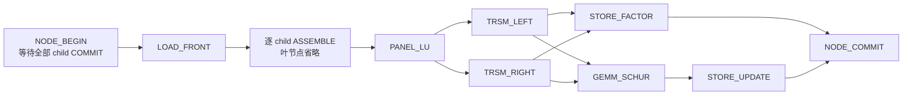
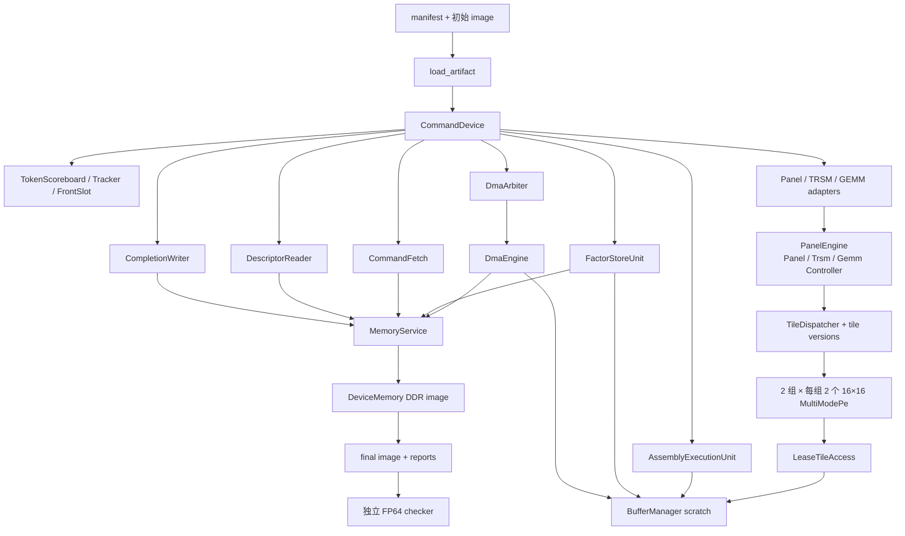

# 当前实现技术导读

核对日期：**2026-10-05**。依据是当前工作区代码（基线提交 `497357c2235b491e7bb75c323b9d01f24e8d874c` 加已有未提交修改），不是该提交单独的状态。本次仅审查与写文档，没有修改功能代码，也没有推进 T12。

项目已经能够把稀疏方阵编译成 Command/Descriptor schema v2 artifact，并在真实 FP32 / 局部 INT32 GEMM 设备行为路径上完成 **STATIC 多前沿 LU 分解**：装配、Panel、左右 TRSM、Schur、L/U/P/update 写回都执行实际数据访问和计算。**设备树形前代/回代、solution 写回和原方程 Ax=b 验收仍未完成。** “真实”在本文指模型执行真实输入、输出与状态机，不表示已有对应完整 RTL 或芯片实现。

本次发现一项主线严重异常生命周期缺陷，以及两项独立 RTL 原型的严重接口缺陷；未做修复。正常 fixture 回归通过不覆盖这些缺陷。详情与可复现源码在[本次审查与验证报告](当前实现审查与验证报告.md)。

## 阅读路线

第一次阅读建议按 **第 1 章能力边界 → 第 2 章数学概念 → 第 7 章两层树案例 → 第 4、5 章设备执行 → 第 3 章软件编译** 的顺序。查具体类时使用[完整类、类型与函数索引](当前实现类型与函数索引.md)，其中有 254 个 C++/Python 类型定义及 RTL module、Python 函数调用说明。

- [1. 目标、进度与证据](#1-目标进度与证据)
- [2. 数学概念与数据含义](#2-数学概念与数据含义)
- [3. 软件编译流水线](#3-软件编译流水线)
- [4. SystemC 架构与逐拍流程](#4-systemc-架构与逐拍流程)
- [5. 计算模块及共享资源](#5-计算模块及共享资源)
- [6. 错误、abort 与 reset](#6-错误abort-与-reset)
- [7. 实际案例：两层树](#7-实际案例两层树)
- [8. 验证、报告与复现](#8-验证报告与复现)
- [9. 限制、文档差异及源码阅读顺序](#9-限制文档差异及源码阅读顺序)

## 1. 目标、进度与证据

最终问题是给定稀疏方阵 A 和 RHS b，求解 Ax=b。软件把全局稀疏结构分解为许多局部稠密 front；设备执行这些 front 的计算，并通过消除树传递 Schur update，避免把全局矩阵当一个大稠密矩阵处理。

**当前正式入口输出的是分解结果。** `tree_factor_device` 接收含 `manifest.json` 与 `memory_image.bin` 的目录，要求 `factorization_only`；输出最终 DDR image、命令与节点状态、资源时序报告。`tree_factor_check` 再独立检查每节点完整 L/U/update 和局部 P-vector。RHS/solution 区域和 solve descriptor 可能已分配，但这不表示设备已产生可验收的解。

| 阶段 | 已有成果和源码事实 | 本次可用证据 / 边界 |
|---|---|---|
| T00 | 当前目录、旧 NodeTask ABI/旧精度实验边界冻结 | [根目录说明](../README.md)与 CMake 不链接 archive |
| T01 | schema v2：Command 32B、Descriptor 64B、Completion 64B，显式主元策略 | [Python codec](../graduation-code/software/src/command_codec.py)、[C++ codec](../graduation-code/systemc/include/command_codec.hpp)，共享二进制 fixture 回归 |
| T02 | 独立 Python/C++ FP64 分解与求解参考 | [front_reference.py](../graduation-code/software/src/verify/front_reference.py)、[fp64_reference.cpp](../graduation-code/systemc/reference/src/fp64_reference.cpp)，同策略跨语言 fixture |
| T03 | 数值预处理、ordering/fill/森林/supernode/front/map、artifact 编译 | [pipeline.py](../graduation-code/software/src/pipeline.py)、[command_compiler.py](../graduation-code/software/src/scheduler/command_compiler.py)，Python 120 tests 与两模式完整 CLI |
| T04 | DDR、异步内存服务、descriptor 读取、scratch lease、1D/2D DMA | [dataplane](../graduation-code/systemc/include/dataplane/)，core/SystemC/artifact tests |
| T05 | 取指、token 依赖、双 front、单元/DMA/completion 编排 | [control_plane.cpp](../graduation-code/systemc/src/controlplane/control_plane.cpp)；既有 test stub 测试仅证明控制语义 |
| T06 / T08 | 16×16 多模式 PE 原型、Panel/TRSM 微架构与共享接口 | [PanelLuPrototype](../graduation-code/systemc/include/panel_lu/panel_lu_prototype.hpp)、[TRSM 设计](architecture/TRSM架构设计.md)；T06 合成数值不算正式验收 |
| T07 | STATIC FP32 Panel A11 分解、全 front 扫描与主元阈值、P-vector 写回 | [PanelController](../graduation-code/systemc/src/panel_lu/panel_controller.cpp)、[tile kernels](../graduation-code/systemc/src/panel_lu/tile_kernels.cpp)，真实 Panel tests |
| T09 | 顶层左右 TRSM、命令占组、统一读写仲裁、完整 L/U 保存 | [TrsmController](../graduation-code/systemc/src/panel_lu/trsm_controller.cpp)、[FactorStoreUnit](../graduation-code/systemc/src/controlplane/panel_exec_unit.cpp#L527)，真实 TRSM tests |
| T10 | 顶层 GEMM_Schur、局部 FP32→INT32→FP32、SCALE_DESC | [GemmController](../graduation-code/systemc/src/panel_lu/gemm_controller.cpp)、[precision_adapter.cpp](../graduation-code/systemc/src/panel_lu/precision_adapter.cpp)，GEMM 与跨语言配置 tests |
| T11 | DDR child update→真实 extend-add→parent 分解，树/森林、独立 checker | [AssemblyExecutionUnit](../graduation-code/systemc/src/controlplane/assembly_exec_unit.cpp)、[设备 CLI](../graduation-code/systemc/src/tree_factor_device.cpp)，24 个 artifact 中 23 个通过数值验收、1 个受控数值失败 |
| T12 | 真实树形 solve、solution 与 Ax=b | **未实现**；reference solve 与 stub solve 不抵此项 |
| T14 / T13 / T15 | HPU/ATU 契约统一、动态执行、RTL 控制与事务对照 | **尚未形成主线闭环**；独立 HPU/ATU 模块存在，不能推导动态整树完成 |

T16 分层验证已有持续积累；T17 实际矩阵统计/性能实验和 T18 最终交付收口不能由上述局部通过直接认定完成。任务定义以[任务说明书](项目实现任务说明书.md)为入口，当前事实须结合源码与本次证据理解。

## 2. 数学概念与数据含义

### 2.1 从消去变量到一棵树

消去第 k 个变量会让它尚未消去的邻居发生新的连接，这些新增非零称为 **fill**。符号分析只预测连接，不进行数值消元。本项目先在变换后的 B 上取 `pattern(B) ∪ pattern(Bᵀ)`，获得保守的对称结构包络，但矩阵数值仍可非对称。

**消除树**描述消去结果往哪个后续节点传递；独立连通部分形成多根**森林**。若多列的填充结构满足连续合并条件，就把它们合成一个 **supernode**，作为一次局部稠密计算的 pivot block。

节点的 **front** 是一个有序变量集合及其局部稠密矩阵。前 p 个变量由本节点消去，后 u 个继续交给祖先，n=p+u：

```text
            本节点消去 p 列       继续上传 u 列
本节点 p 行     F11 (p×p)           F12 (p×u)
上传部分 u 行   F21 (u×p)           F22 (u×u)
```

STATIC 下计算：

```text
F11 = L11 U11                     Panel-LU，L11 单位下三角
L11 U12 = F12                     TRSM_LEFT
L21 U11 = F21                     TRSM_RIGHT
S = F22 - L21 U12                 GEMM_SCHUR
L = [L11; L21]，U = [U11 U12]     持久因子
update = S                        上传父节点
```

`TRSM_RIGHT` 的 XU=B 沿 **列号递增**代入：`x[j]=(b[j]-Σ(t<j)x[t]U[t,j])/U[j,j]`，不能因为 U 是上三角就误用行向后代入。

### 2.2 extend-add 并不是简单拼接

每节点初始 front 只放归属本节点的原矩阵贡献；`extract_local_contribution` 把 update-update 右下块清零，避免不同 front 重复拥有同一原始元素。父节点先加载自己的本地贡献，再把每个 child 的 Schur update 映射进去相加。

当前 schema 的 map 含义容易误读：`row_map` 表示 **child update 来源顺序**，`col_map` 表示 **parent front 位置**；每张表同时作用于行和列：

```text
parent[col_map[i], col_map[j]] += child[row_map[i], row_map[j]]
```

这不是“一张只映射行、另一张只映射列”的任意矩形散射接口。源码证据为[装配的 source_offset/target_offset](../graduation-code/systemc/src/controlplane/assembly_exec_unit.cpp#L83)和[软件 map 生成](../graduation-code/software/src/scheduler/map_gen.py)。多个 child 可以分别贡献到父节点相同位置，逐条命令累加；单条 map 内重复目标则拒绝。

例如 child 初始 front `[[4,1],[2,0]]`，p=1，得到 `L=[1,0.5]ᵀ`、`U=[4,1]`、update=`-0.5`。parent 本地值为 5，map 将这个 update 加到 parent(0,0)，装配后为 4.5，父节点因子就是 L=1、U=4.5。第 7 章用真实 fixture 对照每一步。

### 2.3 三种置换不要混用

软件使用 gather 约定：`y[i]=x[perm[i]]`。

1. 行均衡 `D_r` 同时作用于 A 和 b；没有列缩放，因此恢复解不用反向缩放。
2. 加权匹配产生 `row_perm_match`，把每列所匹配的原行移到对角位置。它是匹配映射的逆方向，只重排方程。
3. ordering 数组 q 同时重排 B 的行/列。用数组写法最明确：

```text
B = (D_r A)[row_perm_match, :]
A_hat = B[q, :][:, q]
b_hat = (D_r b)[row_perm_match][q]
x_hat[i] = x[q[i]]
恢复：x[q] = x_hat
```

**设备局部 P-vector** 是另外一回事：每节点长度 p、INT32、初始全 -1。STATIC 成功后写 `[0,1,...,p-1]`。DYNAMIC_PANEL 的目标是仅在当前 pivot block 剩余行内选择/交换；不能从 update 行拉入主元。参考支持这一数学策略，当前真实设备显式返回 `POLICY_NOT_SUPPORTED`。

STATIC 检查的是**消元后的实际主元**。即使输入对角都非零，也可能在消元中产生零主元。阈值比例先统一舍入为 FP32，实际比较使用它与装配后、消元前**全 front 最大绝对值**的乘积；这个尺度冻结后供 Panel/TRSM 使用。STATIC 失败不等于矩阵奇异，也不会自动扰动主元或切换策略。

### 2.4 FP32 与局部 INT32

front、L/U、update、extend-add、Panel、TRSM 始终使用 FP32 存储/正式运算。INT32 模式只改变顶层 `GEMM_SCHUR` 的每个 K 分块：

```text
FP32 L21/U12 tile
 → 各自 maxabs / 二次幂 scale
 → RNE ties-to-even 量化到 INT32
 → INT32 乘法、带显式检查的 INT64 累加
 → 正确舍入回 FP32 partial product
 → FP32 C := C - partial product
```

默认为 30 effective bits，范围 `±(2^29-1)`，K≤16，使点积绝对值上界小于 `2^62`。底层仍检查每次累加，不依靠有符号溢出后再判断。饱和按 FAIL 或 CLAMP_AND_REPORT 明确处理，后者继续计算并记录计数。SCALE_DESC 在运行时通过内存事务读取；manifest 的模型位宽/K/速率是 boot 参数，两者职责不同。

scale 不成为全树格式，但**误差会随数据传播**：child INT32 Schur 的 FP32 输出写 DDR，经 parent extend-add 后改变 parent 的实际主元。T11 `pivot_propagation` 就验证了 FP32 保留 `-2^-35`、INT32 量化成零并引发静态主元失败。不能把两种模式的控制结束都计为数值 PASS。

## 3. 软件编译流水线

入口是[main.py](../graduation-code/software/src/main.py)→`PipelineConfig`→[run_pipeline](../graduation-code/software/src/pipeline.py#L57)。它并不调用 SystemC。

| 步骤 | 输入 → 输出 | 关键实现与检查 |
|---|---|---|
| 读入/规范化 | 文件或随机方阵 → FP64 CSR；读取或生成 b | matrix_io；canonicalize_csr 去重、去显式零、排序、方阵/有限值检查 |
| 均衡 | A,b → D_r A,D_r b,row_scale_e | equilibrate_system；二次幂行缩放，记录前后 maxabs |
| 匹配 | 均衡矩阵 → 行 gather 数组 | compute_row_matching；最大化匹配非零绝对值乘积，等价于 log 目标；无完整匹配显式失败 |
| ordering | B 的对称结构包络 → q | compute_ordering：identity/rcm/amd；amd 是当前 Python 图消去算法，并非 SuiteSparse 实现 |
| fill/森林 | 排序后结构 → filled columns,parent | symbolic_fill_pattern；每步连接较大邻居，最小较大邻居为 parent |
| supernode/front | filled columns → 节点区间、变量前缀/后缀 | build_supernodes_from_filled、build_supernode_parent、build_front_indices_from_filled |
| map/本地贡献 | parent/front_indices、A_hat → maps/local_fronts | generate_map_tables、extract_local_contribution；pivot 在前，F22 初值清零 |
| command 编译 | NodeCompileRecord、fronts、maps、q、b_hat → image/manifest | compile_command_artifact；IR 结构检查、符号依赖计划、地址规划、codec 与 manifest 校验 |
| 可选 host 预检 | 原输入与同策略 front 树 → 参考解及指标 | reference_check 默认 false；结果只写 host 文件，不回填 device image |

### 3.1 编译器怎样把“树”变成字节

[command_compiler.py](../graduation-code/software/src/scheduler/command_compiler.py)先创建 `_RegionSpec`（形状/格式/初值）、`_DescriptorSpec`（按名字引用）、`_CommandTemplate`（按 `(node,token_name)` 依赖）。`_build_commands` 最多打开两个节点，按拓扑约束交错发命令，再把引用改成整数 token。每条 wait 都引用之前已发出的 producer，command id 和 token 连续分配。

每节点计划为：



这是**依赖图**，不表示同一 front 的左右 TRSM 同时执行：设备目前用 front busy 保守串行化同 front 的访问。p=n 的节点省略 TRSM/GEMM/STORE_UPDATE，Panel 后直接保存因子再 commit。

[planner.py](../graduation-code/software/src/memory/planner.py)用 u64 安全加法/对齐布局区域。随后 `_resolve_descriptor` 把名字解析为 descriptor id、DDR 地址和 payload offset，显式编码为小端字节。不能用本机 C++ `sizeof(struct)` 解释外部记录。

### 3.2 artifact 文件与检查层次

`memory_image.bin` 内包括 command buffer、descriptor table、payload、completion 模板、全局 permutation/RHS/solution 和每节点 front/update/L/U/P/solve workspace。分解模式省略 solve **命令**，不保证省略相关存储和 descriptor。

`manifest.json` 说明 schema、区域布局、节点、命令/descriptor 数量、主元策略、GEMM 后端/模型配置、operation_scope。`front_f64.bin`、原矩阵/RHS/reference 解等在 image 外；完整 pipeline 会生成部分 host 参考输入文件，但设备 loader 不要求它们存在。

检查由多层承担：Python config 检查参数；compiler 检查 IR 与 batch；manifest validator 核对区域、描述符、父子准入依赖、P-vector 和元数据；C++ loader 再做静态一致性检查；运行时 DescriptorReader 和计算 adapter 继续核对真实读取到的视图与支持的算子形状。**加载成功不意味着所有运行时形状检查都已通过**，本次 B01 的复现就在最后一层正常拒绝请求时触发 abort 缺陷。

CLI 关键选项包括 `--mtx` 或 `--n/--density`、`--max-supernode-size`、`--factorization-only`、`--gemm-backend`、`--out`，以及显式 `--reference-check`。其他选项以 `python -m src.main --help` 为准；不要把默认包含 solve 的 artifact 交给 T11 分解入口并据其拒绝判定分解失败。

## 4. SystemC 架构与逐拍流程

### 4.1 对象关系：命令和 tile 是两层



`DataPlane` 拥有图中的 DeviceMemory、MemoryService、BufferManager、DmaEngine、DescriptorReader 和 TraceRecorder。`CommandDevice` 拥有控制对象、统一 OnChipArbiter、执行单元池与共享 PanelEngine。checker 是外部程序，没有通往设备计算输入的回边。

**command** 是软件发出的完整操作；**TileTask** 是 controller 为执行该操作动态生成的内部工作项。外部 ABI 不直接暴露每个 tile 的 task graph。一个 PE 指一整套 16×16 模块，不是一个乘加单元；Panel/TRSM/GEMM 共用四个模块。每条计算命令独占一组，两组可服务两个命令；组内两个 PE 可处理该命令不同 tile。adapter 数量与物理 PE 数量不是同一参数。

### 4.2 一个 tick 的事实顺序

[CommandDevice::tick](../graduation-code/systemc/src/controlplane/control_plane.cpp#L356)不在内部等待 SystemC 时间，调用一次推进一个模型周期：

1. `DataPlane::begin_tick` 增加 cycle；OnChipArbiter 初始化本拍读/写预算，同周期重复 begin 是幂等的。
2. `tick_memory_and_route` 完成到期 DDR 事务，按 client/epoch 投递响应。
3. `update_phase` 消费取指、completion、DMA 结果；tick **一次**共享 PanelEngine；tick/poll 各 adapter；处理 descriptor、P-vector 输出与重试。
4. `dispatch_phase` 从 FIFO/窗口选择命令，等待依赖或申请 front/lease/单元，提交具体工作。
5. `issue_phase` 推进取指、completion 写与 DMA 仲裁发射。
6. `tick_clients` 推进 DescriptorReader 和 DmaEngine；最后检查全 batch 是否已终态且单元/DMA 排空。

Panel/TRSM/GEMM adapter 的 `tick` 是 no-op，避免多个 adapter 把同一物理引擎一拍推进多次。[PanelEngine::tick](../graduation-code/systemc/src/panel_lu/panel_engine.cpp)依次推进 PE、汇集任务响应/commit、dispatcher、取消请求、controller、终态汇总。

普通 CLI 调用有界 `run(max_cycles)` 重复 tick。SystemC 测试线程在 `sc_clock` 每个上升沿调用同一个 tick；不是另一套算法。三层树本次对照 FP32 1114 拍、INT32 1125 拍，普通驱动与时钟驱动最终 image 完全一致。这个一致性证明两种驱动对当前模型等价，不能推导真实硬件频率或 RTL 时序。

### 4.3 各种“内存”分别是什么

| 层次 | 存什么、谁拥有 | 访问/释放规则 |
|---|---|---|
| DDR image | 初始 front、持久 L/U/update/P、ABI 表和状态；DeviceMemory 拥有 | 静态 region，跨节点保留；MemoryService 到完成拍才实施读写；不会在 child commit 后释放 update |
| scratch slot | 驻留 front 与 child 临时 update；BufferManager 拥有 | 默认 5 槽、每槽 64 KiB；节点申请 front/temp 两槽，读取/写入需 lease；回收递增 generation |
| PE staging | 当前 task 的有效操作数与结果，物理 tile 16×16 | MultiModePe task slot/FIFO/累加器容量约束；算完后还须等待预算、写回与 commit |
| Assembly staging | child/parent/result 三个 FP32 标量，共 12B | 四阶段逐元素推进；不是隐藏的完整 FP64 front |
| Factor staging | 当前 front 行及转换后的 L/U 行 | 有限逐行 staging，读额度/DDR 背压下保留进度 |
| 带宽预算 | 每拍允许多少字节访问 scratch | OnChipArbiter 的读/写两个域，默认各 64B/cycle；每方向仅一个 requester，余量不转授 |

lease 是访问授权，不是数据副本；generation 防旧槽引用，epoch 防 reset 前旧事务，tile version 保证同一次计算中读写顺序。三者解决的问题不同。

默认每槽 64 KiB 意味着紧凑 FP32 n×n front 在此配置下最多 n=128。软件默认 max_front_size=256 是编译上限，不保证默认设备容量可容纳；过大 front 应明确 `BUFFER_FULL`，不能把“编译成功”当成默认设备可执行承诺。

## 5. 计算模块及共享资源

本章解释核心类的创建、状态、方法及上下游。全部辅助类型、枚举和内部嵌套结构见[完整索引](当前实现类型与函数索引.md)。

### 5.1 控制与数据基础类

| 类 / 所属文件 | 谁创建/调用，主要状态与方法 | 输入 → 输出，执行作用 |
|---|---|---|
| [CommandDevice](../graduation-code/systemc/include/controlplane/control_plane.hpp) | CLI/测试创建；持有 Tracker、FrontSlot、scoreboard 和所有单元；start/tick/run/abort_node/reset/write_reports | LoadedArtifact+配置→状态、最终 image、reports；连接整条链 |
| [CommandFetch](../graduation-code/systemc/include/controlplane/command_fetch.hpp) | CommandDevice 创建；单未决读取、有界 FIFO；tick 发读，update 解码，at/remove_at 供调度 | DDR command records→待调度 Command；满时停止取指 |
| [TokenScoreboard](../graduation-code/systemc/include/controlplane/token_scoreboard.hpp) | CommandDevice init/register_producer/check/signal；Pending/Ready/Failed | waits→Ready/Pending/Failed；只有自己的 producer 可 signal 一次 |
| [CompletionWriter](../graduation-code/systemc/include/controlplane/completion_writer.hpp) | 控制面 enqueue，tick 发写，update/take_result 收确认；队列/未决 id | Completion→DDR 记录及确认位，写失败为 batch fault |
| [DmaArbiter](../graduation-code/systemc/include/controlplane/dma_arbiter.hpp) | 控制面 enqueue/take_completion/drop_queued；每 front 队列和 active job | 多命令搬运→单通道 DmaRequest；取消只丢尚未执行的 job |
| [DataPlane](../graduation-code/systemc/include/dataplane/dataplane.hpp) | CommandDevice 或数据面测试创建；分相 tick、sink 路由、reset | 组织内存、DMA、scratch、reader，自己不决定 LU 数学 |
| [DeviceMemory](../graduation-code/systemc/include/dataplane/device_memory.hpp) | DataPlane 创建；image/regions，check/read/write | 用途、边界、对齐、只读区检查后的字节存取；区域 role 由名称分类 |
| [MemoryService](../graduation-code/systemc/include/dataplane/memory_service.hpp) | DataPlane 创建；inflight、response queue、port_free_cycle、epoch；submit/tick/pop | 请求先校验再排队，按 beat/startup 模拟串行端口，到期实施数据操作 |
| [DescriptorReader](../graduation-code/systemc/include/dataplane/descriptor_reader.hpp) | DataPlane 创建，控制面 request/poll；Task 经 Record/References/Payload/Done | DDR descriptor/payload→Front/Factor/Contribution/Kernel/Solve/Dependency 视图；无 host 数值旁路 |
| [BufferManager](../graduation-code/systemc/include/dataplane/buffer_manager.hpp) | DataPlane 创建；Slot/Lease、owner、generation、有效范围、端口计数 | allocate/rearm/begin_load/read/write/writeback→handle/lease；end/release/abort/reset 收尾 |
| [DmaEngine](../graduation-code/systemc/include/dataplane/dma_engine.hpp) | DataPlane 创建；Idle/Active/ResponseHold、当前 row/beat/staging；valid/ready/tick | 二维 DDR stride↔紧凑 scratch；整次范围预检后逐 beat 传输；响应保持到消费 |
| [OnChipArbiter](../graduation-code/systemc/include/dataplane/on_chip_arbiter.hpp) | CommandDevice 创建并共享给 DMA/PE/scan/assembly/factor；begin_cycle/acquire/clear_pending | requester+需要字节→grant；pending 轮转，取消/结束清除旧请求 |
| [TraceRecorder](../graduation-code/systemc/include/dataplane/trace.hpp) | DataPlane 持有，内存/buffer 添加事件；write_csv | 输出原始事务/生命周期证据，不参与决定计算结果 |

### 5.2 共享计算子系统

[PanelEngine](../graduation-code/systemc/include/panel_lu/panel_engine.hpp)由 CommandDevice 创建，`begin_command` 为一条命令申请 Context/组，绑定真实 front lease，并按 ComputeKind 创建 `PanelController`、`TrsmController` 或 `GemmController`。`LeaseTileAccess` 负责以 `binding.base_offset + operand.offset + row*stride` 访问 scratch；`LeaseFrontReader` 负责扫描完整 front。引擎保存版本表和 task trace，`poll_response(adapter_key)` 取走终态后释放 context/组/版本绑定。

`IComputeController` 统一 `start/tick/on_task_response/on_tasks_cancelled/request_abort/poll_response`。controller **提出任务**，不直接执行整个矩阵。`TileDispatcher` 的队列有上限，只有 task deps 已 commit、源版本可读、目标版本匹配、没有未提交同目标写者且本组 PE 有容量时才派发。队列满时 controller 保留生成进度，不能丢任务。

[MultiModePe](../graduation-code/systemc/include/panel_lu/pe_model.hpp)拥有多个 task slot、操作数 FIFO 和独占运算资源。接收任务不立即读取全部输入；Loading 在统一读额度下分段取得有效区域，执行数值原语时产生隔离的结果，最后在写回额度和预约席位允许后写入 scratch。**数值函数返回、PE 执行结束、真实写回完成、dispatcher commit 是不同事件。** 只有成功可见结果才能提交版本并唤醒后续依赖。

一个 16×16 tile 物理 staging 容纳 256 个 FP32，尾块只读取/计算/写回有效 M/N/K。Panel 内部与顶层 TRSM 的更新也使用 PE 的 GEMM_UPDATE，但它们保持 FP32，不因全局选择 INT32 后端而改变。

### 5.3 Panel、TRSM 与 GEMM controller

| controller | 状态/任务关系 | 成功与失败 |
|---|---|---|
| [PanelController](../graduation-code/systemc/include/panel_lu/panel_controller.hpp) | 扫描 n×n 检查有限值并冻结尺度；按 pivot tile 步生成 LU_DIAG→左右 TRSM→GEMM_UPDATE，等该步写回提交后下一步 | 只分解 A11；非有限、零实际主元、阈值失败明确返回列坐标；STATIC P 写由控制面后处理 |
| [TrsmController](../graduation-code/systemc/include/panel_lu/trsm_controller.hpp) | 左解目标 A12 从 (0,p) 起，右解 A21 从 (p,0) 起；每步先 solve，再对后续块增量发 update，最后屏障 | 使用 Panel 冻结尺度；右解 U 对角先检查并预计算倒数；成功才允许持久因子保存 |
| [GemmController](../graduation-code/systemc/include/panel_lu/gemm_controller.hpp) | A22 从 (p,p) 起，A21×A12 更新；同 K 步多个输出 tile 并行，全部 commit 后下一 K 步 | 顶层 M/N/K=u/u/p；FP32 或局部 INT32；p=n 时编译器省略，运行时空 update 不伪执行 |

Panel 的 FrontGrid、TRSM 的 A12/A21、Schur 的 A22 使用不同 `TileViewTag` 版本键。尤其 p=23 时 A12/A21 起点不是 16 对齐，不能把整个 front 的 tile 网格索引直接当边块索引。现有 n=42,p=23,u=19 测试覆盖这些尾块、偏移和 guard。

`PanelExecutionUnit/TrsmExecutionUnit/GemmExecutionUnit` 是 command 级 adapter，负责核对 descriptor、front 身份与模式并转译请求/响应。它们共同引用同一 PanelEngine；`adapter_key` 包含 kind 和 unit_id，避免不同种类的 0 号 adapter 混收响应。正式后端没有真实 Solve 单元，不会静默回退 TestStubUnit。

### 5.4 Assembly 与 FactorStore

[AssemblyExecutionUnit](../graduation-code/systemc/include/controlplane/assembly_exec_unit.hpp)由控制面创建。先由控制面验证 ContributionView 并把 child DDR update 用 DMA 载入 parent temp；随后单元同时获得 temp 读 lease、parent 写 lease。`ReadChild→ReadParent→Add→WriteParent` 每元素两次 4B 读、一次 4B 写，加法按配置延迟；只有全部元素真实写入才返回成功。无 grant/lease 未到 ready_cycle 时等待。已完成写不会因后续失败回滚；非有限输入或加法结果直接失败。

[FactorStoreUnit](../graduation-code/systemc/include/controlplane/panel_exec_unit.hpp)独立于 PE 池，将 packed front 转为 `L(n×p)` 和 `U(p×n)`：L11 下三角来自 packed 值、对角填 1、上三角填 0；L21/U12 为顶层 TRSM 真实结果；U11 下三角填 0。逐行读入 staging，分别提交 L/U 行写，某一行只有 L 已被接受而 U 背压时保留标记，重试不能重复提交 L。通过 `pending_ids_` 精确路由 DDR 确认。全部写确认后才返回，成功持久因子字节数为 `8np`。

STORE_UPDATE 则由 DMA 将 scratch 的 A22 子矩形写到单独 update 区域。scratch 中已分解的 front **不会作为最终持久 packed front 回写原始 front 区**；最终结果应从 L/U/update/P 区读取。

## 6. 错误、abort 与 reset

正常完成路径为：执行单元响应→释放命令 lease→enqueue completion→CompletionWriter 写 DDR→确认→scoreboard signal READY/FAILED。数值失败也是命令终态；其消费者收到 FAILED 后传播依赖失败。batch 可以控制流完成而数值状态失败。

资源准入规则是父节点 `NODE_BEGIN` 等待全部 child 的 **commit token**，不是只等某个 child 的算术结束。child 自己 commit 流程完成后 scratch 可复用，其 DDR update 在静态分配区中继续存在。parent 获得自己的 front/temp，并保留到本节点 commit 收尾；不会复用 child scratch 作为父节点长期输入。

实际 trace 还能细分“commit”：NODE_COMMIT 的 finish 是逻辑收尾，scratch 可以在本节点相关执行/写回已终态后释放；其 completion 确认和 READY token 可能晚数拍。父节点依赖的是后者，所以不会提前准入。第 7 章 child scratch 第 433 拍释放、commit token 第 438 拍可见就是这一差别。

定向 `abort_node` 设计为停止该节点新工作，取消尚未执行 DMA job / dispatcher 任务；已接收 DMA、正在写回 PE 和 Factor DDR 写仍需排空；等待唯一 ABORTED 终态后再释放 lease。其他节点继续运行。**本次 B01 发现 adapter 的 immediate failure 分支不满足这个终态协议：abort 删除待消费响应，导致永久等待。正常执行中的 abort 测试通过不能覆盖这一分支。**

`reset` 是全设备失效：清理 DMA/reader/memory inflight、buffer lease、取指/scoreboard/Tracker、controller/PE/dispatcher，并提高 epoch/generation。`MemoryService` 不恢复已经写到 DDR 的字节，DataPlane reset 也不把 cycle 归零；原始 front 输入区本来未被因子写回覆盖，重启时重新加载这些输入。不要把 reset 当“所有输出立即清零”或事务回滚。初始化 P-vector 哨兵等 boot 校验针对初始 artifact，不能拿运行后 image 冒充新的初始 image。

## 7. 实际案例：两层树

来源：[t11_fixture_gen.py 的 two_level](../graduation-code/systemc/tools/t11_fixture_gen.py)，生产 compiler 生成 artifact；本次用 Release `tree_factor_device` 默认 2 组×2 PE 重新执行，报告放在 `/tmp/grad-review-case`，最终 641 拍，两节点 checker 误差为 0。这是手写编译 IR fixture，绕过全局 ordering，但**没有**预生成因子/参考 front 注入；完整软件流水线另有第 8 章 CLI 证据。

### 7.1 输入与 descriptor

| 节点 | parent / front_indices | p/n | 初始 local front |
|---|---|---|---|
| 0 | parent=1，variables=[0,1] | 1/2 | `[[4,1],[2,0]]` |
| 1 | root，variables=[1] | 1/1 | `[[5]]` |

整个原问题的变换后矩阵可拼成 `[[4,1],[2,5]]`。节点 0 的右下 0 是本地贡献规则，5 属于节点 1。parent contribution descriptor id=29，child=0，parent=1，`row_map=[0]`、`col_map=[0]`。节点 0 的 FRONT/FACTOR id 为 16/15，节点 1 为 23/22。

本次 artifact 总长 5128B，command buffer 0..479，descriptor table 从 512 开始、42×64B，payload 从 3200 开始，completion 从 3328 开始、15×64B。以下 offset 均相对 image 起点：

| region | offset / bytes | 执行后的含义 |
|---|---:|---|
| node.0.front | 4480 / 16 | 原始 local front 仍是 `[4,1,2,0]` |
| node.0.update | 4544 / 4 | FP32 `-0.5`，供 parent DDR 读取 |
| node.0.factor_l | 4608 / 8 | `[1,0.5]ᵀ` |
| node.0.factor_u | 4672 / 8 | `[4,1]` |
| node.0.p_vector | 4736 / 4 | INT32 `[0]` |
| node.1.front | 4864 / 4 | 初始贡献 `[5]`，不是运行后 4.5 |
| node.1.update | 4928 / 0 | 根无 update；零长度不占字节，可与下一 region 起点相同 |
| node.1.factor_l / factor_u | 4928 / 4；4992 / 4 | `[1]` / `[4.5]` |
| node.1.p_vector | 5056 / 4 | INT32 `[0]` |

### 7.2 命令与可见性

本例 command id 与 signal token 数值相同。start/finish 表示命令执行时间；completion 表示外部 token 可见时间。

| id | node | 命令 | 主要 waits | start / finish / completion |
|---:|---:|---|---|---|
| 0 | 0 | NODE_BEGIN | 无 | 41 / 41 / 122 |
| 1 | 0 | LOAD_FRONT | 0 | 192 / 265 / 309 |
| 2 | 0 | PANEL_LU | 1 | 309 / 344 / 357 |
| 3 | 0 | TRSM_LEFT | 2 | 357 / 370 / 380 |
| 4 | 0 | TRSM_RIGHT | 2 | 370 / 391 / 396 |
| 5 | 0 | GEMM_SCHUR | 3,4 | 396 / 409 / 414 |
| 6 | 0 | STORE_FACTOR | 3,4 | 409 / 420 / 425 |
| 7 | 0 | STORE_UPDATE | 5 | 420 / 428 / 433 |
| 8 | 0 | NODE_COMMIT | 6,7 | 433 / 433 / 438 |
| 9 | 1 | NODE_BEGIN | **8** | 438 / 438 / 511 |
| 10 | 1 | LOAD_FRONT | 9 | 568 / 576 / 581 |
| 11 | 1 | ASSEMBLE_EXTEND_ADD | 10,7 | 581 / 589 / 594 |
| 12 | 1 | PANEL_LU | 11 | 594 / 621 / 626 |
| 13 | 1 | STORE_FACTOR | 12 | 626 / 631 / 636 |
| 14 | 1 | NODE_COMMIT | 13 | 636 / 636 / 641 |

读取 descriptor/等待 DDR 端口会使 start 晚于前一 completion；不要按数学操作数反推完整周期。独立且依赖已满足的命令可以在前条 completion 写确认前开始，例如左右 TRSM 都只等待 Panel，而 front busy 在前一执行完成后释放。

### 7.3 数据实际在哪里移动

第 41 拍 node0 分配 scratch slot0/slot1，generation=0。LOAD 将 DDR 4480 的 16B 紧凑搬到 slot0。Panel 处理唯一主元 4，左右 TRSM 形成 U12=1、L21=0.5，Schur 写 slot0(1,1)=-0.5。FactorStore 向 4608/4672 写因子，STORE_UPDATE 向 4544 写 update。

第 433 拍 node0 两个 scratch 槽释放，generation 增至 1；第 438 拍 commit token=8 READY，node1 才获准使用同样 slot0/slot1 的 generation=1。它先从 DDR 4864 加载 5；第 581 拍开始从 **DDR 4544** 读取 child 的 -0.5 到自己的 temp slot1，而不是读取旧 child scratch。

第 585 拍获取 parent 写 lease 与 temp 读 lease，按 map 做 `5+(-0.5)`，第 589 拍完成真实 scratch 写入 4.5。随后 Panel、FactorStore 保存根因子。第 636 拍 scratch 再释放为 generation=2，641 拍最后 completion 确认，设备 batch 完成。独立 checker 重新从**初始 image**构造这棵树，读取最终 L/U/update/P 进行比较。

## 8. 验证、报告与复现

### 8.1 本次重新执行结果

| 验证 | 2026-10-05 本次结果 | 证明范围 |
|---|---|---|
| Python | **120 passed，14 warnings** | 软件预处理/编译/codec/参考语义；警告含故意溢出负例及 SciPy 弃用提示 |
| Release CTest | **32/32**，18.69s | 当前 CMake 注册的普通 C++、SystemC、fixture、CLI 与 checker 回归 |
| ASan+UBSan CTest | **32/32**，106.16s | 同一回归在 sanitizer 下通过；macOS 使用 detect_leaks=0，**未启用 leak detector** |
| T11 树回归 | 24 个 artifact，23 个 checker PASS，1 个预期数值失败 | 正向最大归一化误差 `2.635596409e-7`；不是实际矩阵总体成功率 |
| 完整软件 CLI FP32 | 16 节点、155 命令、344 descriptor，9521 拍 | 所有设备命令 OK，checker 16 节点 PASS，最大误差 `5.27297e-8` |
| 完整软件 CLI INT32 | 16 节点、155 命令、360 descriptor，10041 拍 | 同上；更多 SCALE_DESC，最大误差 `5.27297e-8` |
| 定向异常复现 | B01 在 Release 与 sanitizer 均可复现挂起 | 现有回归之外的异常响应/abort 交叉时序 |
| RTL | cmp/ATU/scoreboard 原有 TB 运行完成；B02/B03 定向断言失败 | 完整 HPU/GCU 部分仿真受 Icarus 支持限制；原 TB 完成也不等于握手断言完备 |

以上是本次结果；todo 和 T11 文档里的 2026-10-04 记录为历史结果。两者数值相同也不能混为同一轮。更完整的测试/工具限制和日志位置见[审查报告](当前实现审查与验证报告.md)。

### 8.2 构建与回归

从仓库根目录运行；使用已有 `.venv` 和 SystemC，无需新增依赖：

```bash
PYTHONDONTWRITEBYTECODE=1 .venv/bin/python -m pytest graduation-code/software/tests -p no:cacheprovider
cmake -S graduation-code/systemc -B /tmp/grad-review-release \
  -DCMAKE_BUILD_TYPE=Release -DBUILD_TESTING=ON -DSYSTEMC_HOME=/usr/local/systemc-3.0.2
cmake --build /tmp/grad-review-release -j8
PYTHONDONTWRITEBYTECODE=1 ctest --test-dir /tmp/grad-review-release --output-on-failure
cmake -S graduation-code/systemc -B /tmp/grad-review-sanitize \
  -DCMAKE_BUILD_TYPE=Debug -DBUILD_TESTING=ON -DENABLE_SANITIZERS=ON \
  -DSYSTEMC_HOME=/usr/local/systemc-3.0.2
cmake --build /tmp/grad-review-sanitize -j8
PYTHONDONTWRITEBYTECODE=1 ASAN_OPTIONS=detect_leaks=0 \
  UBSAN_OPTIONS=halt_on_error=1:print_stacktrace=1 \
  ctest --test-dir /tmp/grad-review-sanitize --output-on-failure
```

CTest 的 fixture setup 会调用当前生产 Python compiler，在构建目录生成 artifact。32 项中既有正向数值验收，也有预期非零退出的负面 CLI 测试；“32/32”是回归断言通过数，不是 32 个数值问题全部成功。

### 8.3 运行设备与独立 checker

```bash
PYTHONDONTWRITEBYTECODE=1 .venv/bin/python \
  graduation-code/systemc/tools/t11_fixture_gen.py --out /tmp/grad-review-fixtures
/tmp/grad-review-release/tree_factor_device \
  --device-dir /tmp/grad-review-fixtures/two_level/fp32/device \
  --out /tmp/grad-review-case --backend FP32_SYSTEMC
/tmp/grad-review-release/tree_factor_check \
  /tmp/grad-review-fixtures/two_level/fp32/device /tmp/grad-review-case
```

完整软件 CLI 从 `graduation-code/software` 运行：

```bash
PYTHONDONTWRITEBYTECODE=1 ../../.venv/bin/python -m src.main \
  --n 24 --density 0.16 --max-supernode-size 4 --factorization-only \
  --gemm-backend FP32_SYSTEMC --out /tmp/grad-review-cli-fp32
/tmp/grad-review-release/tree_factor_device --device-dir /tmp/grad-review-cli-fp32 \
  --out /tmp/grad-review-cli-fp32-report --backend FP32_SYSTEMC
/tmp/grad-review-release/tree_factor_check \
  /tmp/grad-review-cli-fp32 /tmp/grad-review-cli-fp32-report
```

INT32 时编译和运行分别选择 `--gemm-backend FP32_SYSTEMC_INT32_GEMM` 与 `--backend FP32_SYSTEMC_INT32_GEMM`，使用另一输出目录；不能只在运行时改变后端却继续消费 FP32 artifact。

### 8.4 怎样判定验收，而不误读 PASS

| 文件/字段 | 含义 |
|---|---|
| summary.control_flow_pass | 全 batch 达到已完成状态；命令失败也可能正常收尾 |
| summary.numeric_status_pass | 真实后端、未用 stub、全部命令 completion OK；不是误差验收 |
| summary.numerical_validation | 设备本身固定 not_performed，不能自行认证数值 |
| validation.numeric_pass / numerical_validation | 外部 FP64 重算及最终 image 比较的 PASS/FAIL |
| validation.solve_validation | 当前 not_performed，不能由因子验收推导 Ax=b 已通过 |
| commands.csv / nodes.csv | 定位哪个 opcode/node 失败，是否成功 commit，以及 command start/finish/completion |
| units.csv / fronts.csv | adapter 使用和 scratch 驻留区间；不是门级功耗/面积证据 |
| panel_tasks.csv | 每 tile 的 mode、PE/group、版本、写回/commit、失败与周期 |
| transactions.csv / buffers.csv | DDR/DMA 流量和 buffer owner/generation/lease 状态迁移；不同层流量不能简单相加当 DDR 总量 |
| final_memory_image.bin | 实际设备输出的完整 image；按初始 descriptor/region 读取结果 |

checker 从初始 FP32 local fronts/maps 独立计算 FP64 树分解，比较 L/U/update 的 `max(abs(actual-reference))/max(1,max(abs(reference)))`，默认容限 `1e-4`，P-vector 要求 STATIC identity。它不调用设备 LU/TRSM/GEMM 内核，也不读 `front_f64.bin` 作为运行结果。

独立性也有边界：checker 与设备共享 codec/loader，并相信 artifact 描述的结构。因而它主要证明**对该 artifact 的分解正确**，不能单独证明原 A→预处理→front 编译没有错误；那部分依靠 Python 变换语义与 reference 交叉测试。当前还没有读取设备 solution 来检查原始 Ax=b 的路径。软件 CLI 的 `scaled_residual_norm: 0` 来自生成 RHS 时已知的 x_true，自身不提供任何设备求解证据。

## 9. 限制、文档差异及源码阅读顺序

### 9.1 已确认问题与声明限制分开

- **B01（主线，严重）**：TRSM 立即拒绝请求的待消费响应被 abort 删除，Tracker 永久等待并持有 front。正常 fixture 与正常算子数值结果没有因此被证明错误，但异常恢复不能宣称完备。
- **B02（独立 RTL，严重）**：HPU 一次结果发生两次 valid/ready 接收。
- **B03（独立 RTL，严重）**：ATU cfg 与 pivot 并发时 ready 同为 1，实际只执行 swap，丢 cfg 写入。
- T12 solve、T14 动态整树、完整 RTL GCU/GEMM、规模扫描/面积/真实芯片性能，都是明确未完成边界，本次不把它们本身作为 BUG。

每项问题的触发条件、准确源码位置、最小复现、测试遗漏原因和最小建议见[审查报告](当前实现审查与验证报告.md)。目前没有声称“项目没有 BUG”或“所有支持输入已证明正确”。

### 9.2 已遇到的文档与代码差异

| 位置 | 过时或容易误读的描述 | 当前代码事实 |
|---|---|---|
| 根 README 当前推进顺序 | 停留 T05、下一步 T06、尚未迁移 | 当前工作区已有 T07/T09/T10/T11 正式实现 |
| 验证计划 §2 的 L2 列表、todo 旧 T07 小节 | Assembly 未实现、数值仍 test stub | AssemblyExecutionUnit 已接入真实设备，后文 T11 记录更新但旧小节未同步 |
| panel_exec_unit.hpp 文件头 | FactorStore 只写 p×p、不写 L21/U12 | stage_row 实际完整写 L(n×p)、U(p×n) |
| hardware README 架构示意 | “完整 … Solve 模型” | 仅参考有真实 solve；设备未绑定真实 Solve 单元 |
| 设计名 PrecisionAdapter/Int32GemmBehavioral | 容易被当作现有 C++ 类 | 当前是 precision_adapter.cpp 函数集合；PE 调用这些函数 |
| RTL GCU 名称 | 易与 schema v2 CommandDevice 对应为已集成 | gcu_top 为空，其他 GCU 仍是旧 task/计数式原型，默认 tile=32 |

本次没有覆盖修改这些已有文件，避免混入用户的未提交文档工作；本导读提供当前事实入口。

### 9.3 读代码顺序

1. [dataStruct.py](../graduation-code/software/src/dataStruct.py)与 [pipeline.py](../graduation-code/software/src/pipeline.py)：明确 IR、置换与本地贡献。
2. [command_compiler.py](../graduation-code/software/src/scheduler/command_compiler.py)的 `_node_command_plan/_build_commands`，再读 [schema](interface/Command_Schema_v2.md)：理解依赖如何落到字节。
3. [tree_factor_device.cpp](../graduation-code/systemc/src/tree_factor_device.cpp)→[CommandDevice::tick/try_execute](../graduation-code/systemc/src/controlplane/control_plane.cpp)：跟一条 LOAD_FRONT 和一条 PANEL。
4. [BufferManager](../graduation-code/systemc/src/dataplane/buffer_manager.cpp)、[DmaEngine](../graduation-code/systemc/src/dataplane/dma_engine.cpp)、[AssemblyExecutionUnit](../graduation-code/systemc/src/controlplane/assembly_exec_unit.cpp)：回答数据在哪里和什么时候可读。
5. [PanelEngine](../graduation-code/systemc/src/panel_lu/panel_engine.cpp)→三个 controller→[TileDispatcher](../graduation-code/systemc/src/panel_lu/tile_dispatcher.cpp)→[MultiModePe](../graduation-code/systemc/src/panel_lu/pe_model.cpp)→kernels：理解 command 与 task 两层。
6. [FactorStoreUnit](../graduation-code/systemc/src/controlplane/panel_exec_unit.cpp)→completion/token→[独立 checker](../graduation-code/systemc/reference/src/tree_artifact_check.cpp)：理解结果写回、外部可见性与验收。
7. 最后阅读 [T11 设计](architecture/T11_真实装配与树形分解集成.md)、[ControlPlane](systemc/ControlPlane_设计.md)、[DataPlane](systemc/DataPlane_设计.md)、[T07](systemc/T07_Panel_LU数值引擎设计.md)、[T10](architecture/T10_GEMM_Schur与局部INT32设计.md)，将设计理由与已读实现对照。

完整类型入口：[当前实现类型与函数索引](当前实现类型与函数索引.md)。审查边界与本次证据入口：[当前实现审查与验证报告](当前实现审查与验证报告.md)。