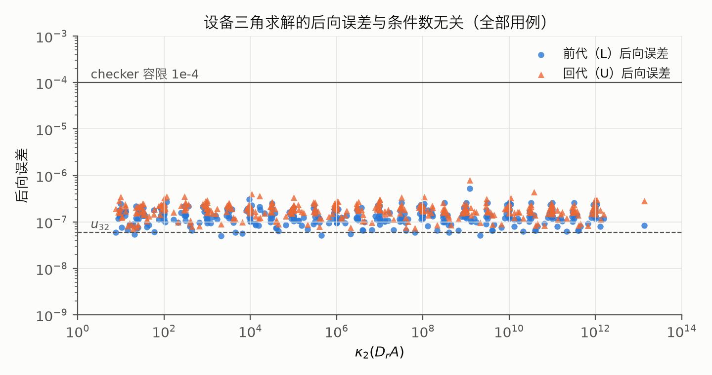
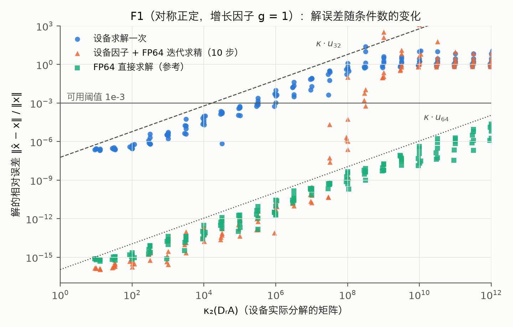
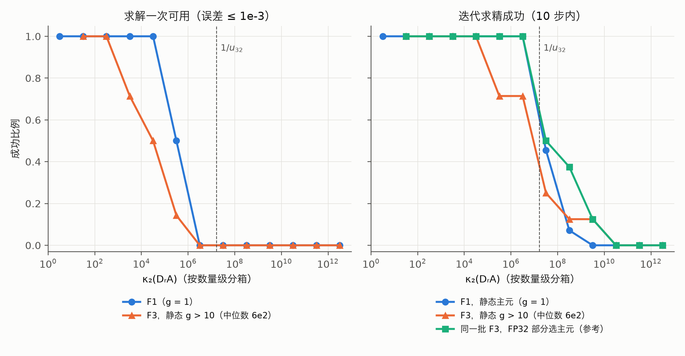
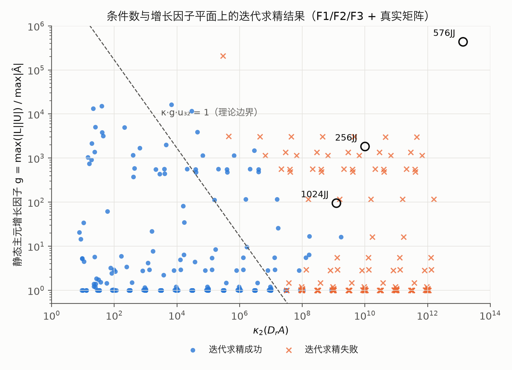

# FP32 设备精度边界实验

更新：2026-10-11。主批次 365 例的原始 JSON、汇总 CSV 与四张图已保存；
8 例 jj1024 结构补跑另批保存，尚未纳入本文主统计和图表。
设备“只求解”及设备修正步复核仍未完成，见 [todo](../../todo.md)。
理论见 [数值误差分析理论基础](../../docs/theory/数值误差分析理论基础.md)，
另一项采用 FP64 三角修正步的分析见 [真实矩阵诊断报告](../real_matrix_diagnosis/实验报告.md)。

代码入口：[precision_boundary](../../graduation-code/software/tools/precision_boundary/)。
`matrices.py` 生成矩阵，`runner.py` 调用生产流程，`analysis.py` 做 host 分析，
`__main__.py` 提供运行/汇总/画图 CLI，`plot.py` 画图；构造测试见
[test_precision_boundary_matrices.py](../../graduation-code/software/tests/test_precision_boundary_matrices.py)。

| 批次 | 内容与证据 | 复核状态 |
|---|---|---|
| [2026-10-11](results/2026-10-11/) | 365 份逐例 JSON、[CSV](results/2026-10-11/results.csv)、四张原图、[metadata](results/2026-10-11/metadata.json) | 原统计保持不变；迁移时 CSV 与原始 JSON 全字段一致 |
| [2026-10-11-jj1024-supplement](results/2026-10-11-jj1024-supplement/) | 8 份逐例 JSON、单独汇总 CSV、[metadata](results/2026-10-11-jj1024-supplement/metadata.json) | 文件完整性与汇总一致性已核查；独立数值复核、主统计与图表更新待办 |

批次元数据保存生成规格、矩阵/右端 seed、编译容量参数、原始结果与输入矩阵 SHA-256。
原执行的确切提交、二进制和完整环境未记录，标为未知；迁移当天源码 hash 单独标注，不能视为原执行版本。
未复制约 123 MB 的生成矩阵、设备镜像与 trace；构造方法和 seed 可用于重新生成输入，
跨环境不保证与旧输入逐字节一致。本次只迁移和核查已有结果，没有重跑设备。

## 1. 要回答的问题

| 编号 | 问题 | 分析用途 |
|---|---|---|
| Q1 | FP32 STATIC 设备求解一次，κ 到多大时解还准？ | 设备直接求解的适用范围 |
| Q2 | 设备 FP32 因子 + FP64 迭代求精把范围扩大到多少？ | 迭代求精作为标准流程的价值 |
| Q3 | 静态主元的元素增长有多大影响？与选主元相比差多少？ | 静态主元的代价，T14 的必要性 |
| Q4 | 设备正确性指标（η_f/η_b、节点后向误差）是否与 κ 无关？ | checker 能区分“设备算对”与“矩阵病态” |

理论预期（理论文档 §6–§8）：求解一次的前向误差 ≈ κ·g·u₃₂；迭代求精在 ρ ≈ c·κ·g·u₃₂ < 1 时收敛到
约 κ·u₆₄，否则发散。理论只给数量级，边界要实测。

## 2. 测试矩阵

稀疏结构取自仓库的真实矩阵（pattern(A) ∪ pattern(Aᵀ) ∪ 对角）或随机对称结构，使消元树和
front 规模接近真实情况；数值是构造的，以便控制 κ 并预先给定真解 x_true。

| 族 | 构造 | 控制量 | 实测性质 |
|---|---|---|---|
| F1 | 加权图拉普拉斯 L = D − W（边权 U(0.1, 1)，非对角元全为负，与电路节点矩阵同类），平移 A = L − sI 使 κ₂(A) 精确等于目标 | κ | SPD，静态消元无增长（g = 1.0）；近零方向是全 1 向量，分布在所有节点上，行缩放不改变 L·1 = 0，管线的均衡去不掉这种病态（实测 κ(A)/κ(D_r·A) ≤ 5.9） |
| F2 | A = S + γ‖S‖₂K，S 为 F1 矩阵，K 为同结构反对称矩阵，‖K‖₂ = 1 | γ | 对称部分正定，静态主元不会为零；**但 κ 塌缩到约 10～30，与目标无关**（反对称部分把近零特征值推开），只覆盖“κ 小、g 大”的角落 |
| F3 | M = L + γ‖L‖₂K（非对称），A = M − μI，μ 取在 M 的最小实特征值稍下方，调节到 κ₂(A) 等于目标 | κ（g 实测） | κ 命中 1e2～1e12（误差 ≤ 2%）；对称部分不再正定（更接近真实矩阵，不保证无零主元）；g 从 1 到 2e5 不等、不随 γ 单调，只能实测记录 |
| real | 仓库的 256JJ、576JJ、1024JJ 原样 | — | 锚点 |

两处设计修订都来自实验本身（2026-10-11）：

1. **F2 的 κ 塌缩**：原设计想用 F2 构成 κ × g 网格。实测加反对称部分后 κ 与目标无关，因此改为
   F1 测纯 κ 边界、F2 测纯增长代价、F3 与真实矩阵一起在 (κ, g) 平面上铺点。
2. **F1 基矩阵从对角占优改为图拉普拉斯**：第一版 F1 用“对角元 = 行和 + 1”的对角占优矩阵，
   λ_min 的特征向量集中在弱耦合的低度数节点上，管线的行缩放能去掉它：随机结构种子 0、2 上
   κ(A)/κ(D_r·A) 达到 1e4～1e5（理论文档 §3.4 所说的“缩放可以去掉的假病态”），FP64 参考解的是
   未缩放的 A，误差因此异常地达到 1e-10。改用拉普拉斯后重跑了全部构造用例，并加了回归测试
   `test_f1_ill_conditioning_survives_row_scaling`。

**所有结果都以实测的 κ₂(D_r·A) 为横轴**，目标 κ 只用于铺点。

## 3. 每个用例的流程与指标

流程：生成 `matrix.mtx` → 生产编译器（默认参数，只按 front 规模逐级放大设备容量：
64 KiB → 128 KiB → 256 KiB → max_front 300 + 512 KiB → 512 + 1 MiB）→ `tree_factor_device`
（FP32_SYSTEMC）→ `tree_factor_check` + `tree_solve_check` → host 分析 → `result.json`。
设备不读取任何 FP64 参考文件；host 分析只在设备运行结束后读取它们。
真解 x_true ~ U(−1, 1)（rhs seed 1），b = A·x_true 用 FP64 计算。

| 指标 | 来源 | 回答 |
|---|---|---|
| κ₂(A)、κ₂(D_r·A)、最小 6 个 σ/σ_max | 稠密 SVD | 横轴 |
| κ₁(D_r·A) 精确值与 `onenormest` 估计值、Skeel cond(D_r·A, x_true) | 稠密逆 / LU | 估计器是否可靠（todo 第 1 项的 host 条件数估计） |
| η_f、η_b、solve_pass | `tree_solve_check` | Q4 |
| 静态增长因子 $g=\max_{ij}(\lvert L\rvert\lvert U\rvert)_{ij}/\max_{ij}\lvert\widehat A_{ij}\rvert$、全局 max\|Â − LU\| / max\|Â\|、节点后向误差最大/中位数、最小主元比 | 设备因子 | Q3 |
| 设备解的原方程后向误差、前向误差 | 设备 `solution_data` | Q1 |
| 迭代求精：每步的后向误差、前向误差、修正量 | host 模拟（见下） | Q2 |
| FP32 部分选主元 LU：增长因子、求解一次及 10 步迭代求精的误差 | `scipy.linalg` float32 | Q3 对照组 |
| FP64 稠密直接求解的前向误差 | numpy | 下界（≈ κ·u₆₄） |

**迭代求精的模拟方式**：第 0 步用设备自己的 `solution_data`；之后的修正步用设备写出的 FP32 全局 L/U，
在 host 上做 FP32 三角求解（LAPACK strtrs），残差和累加用 FP64。host 的 FP32 求解与设备求解舍入顺序不同
（设备逐节点 float 运算，乘加收缩受编译器影响），两者差距实测约为 κ·u 量级（κ = 20：2e-7；κ = 2e5：6.5e-5；κ = 2e9：1.6），
即二者是两次同样合法的 FP32 求解。因此模拟用于估计经验范围，不能代替设备修正步验收；
设备“只求解”入口（[树形求解设计 §6](../../docs/systemc/树形求解模块设计.md#6-执行入口与重复求解约束)）实现后，要在少数用例上复核。

## 4. 判据（2026-10-11 用户确认）

- 求解一次“可用”：前向误差 ≤ 1e-3。
- 迭代求精“成功”：10 步内某一步同时满足原方程后向误差 ≤ 10·n·u₆₄、前向误差 ≤ 10·κ₂(D_r·A)·u₆₄。
- 三角求解验收：求解命令全部 OK，η_f、η_b ≤ 1e-4（`tree_solve_check` 既有容限）；不代表因子或原方程解的精度通过。

## 5. 运行与新批次保存

先按 [项目 README](../../README.md) 构建 Release 设备。
下面在仓库根目录开始，使用新的批次名保存复现实验，不能覆盖已归档批次。

```bash
cd graduation-code/software
EXPERIMENT_RUN="../../experiments/precision_boundary/results/local-reproduction"
BUILD="/tmp/gp-rel"

# 先跑小规模检查；主实验换用 --plan main real，再补 --plan large。
../../.venv/bin/python -m tools.precision_boundary run --plan smoke \
  --out "$EXPERIMENT_RUN/cases" --build "$BUILD" --jobs 2 --max-cycles 80000000
../../.venv/bin/python -m tools.precision_boundary summarize --out "$EXPERIMENT_RUN/cases"
cp "$EXPERIMENT_RUN/cases/results.csv" "$EXPERIMENT_RUN/results.csv"
../../.venv/bin/python -m tools.precision_boundary plot \
  --csv "$EXPERIMENT_RUN/results.csv" --out "$EXPERIMENT_RUN/figures"
```

画图需要 matplotlib（`pyproject.toml` 的可选依赖 `experiments`）。
CLI 在 `<out>/<case_id>/result.json` 缓存逐例结果；上面的 `--out` 指向批次的 `cases/`。
汇总 CLI 将 CSV 写在这个目录内，再复制到批次根目录作为统一入口。
重跑只补缺失用例；`--force` 会重跑覆盖，应仅用于新建的可丢弃复现批次。
保存结果时另写本批次 `metadata.json`：实际参数、环境、代码/二进制身份、种子、输入和输出 hash，
不要直接复制旧批次元数据冒充新运行；当前 CLI 尚未自动生成完整批次元数据。
以下耗时是原报告环境下的记录，不能视作运行时保证。

| 计划 | 内容 | 用例数 | 耗时（本机，4 进程） |
|---|---|---|---|
| smoke | 随机 128：F1 三个 κ、F2 一个、F3 一个 | 5 | 约 3 秒 |
| main | 256JJ 结构 + 随机 256 结构，3 个种子：F1 κ = 1e1～1e12 每半个数量级；F2 γ ∈ {0.3, 1, 3}；F3 κ = 1e2～1e12 每个数量级 × γ ∈ {0.1, 0.3, 1} | 354 | 约 30 分钟 |
| large | 576JJ、1024JJ 结构：F1 κ = 1e2～1e12 每两个数量级；F3 γ = 0.3，κ = 1e4、1e8 | 16 | 576 结构每例约 3 分钟；1024 结构每例约 13 分钟（单进程，见 §7.3） |
| real | 三个真实矩阵 | 3 | 约 6 分钟 |

## 6. 主实验结果（365 个用例，2026-10-11，macOS/clang，Release）

覆盖 main 计划全部 354 例、576JJ 结构的 8 例与 3 个真实矩阵；8 例 jj1024 补跑未并入（§7.3）。
全部用例完成编译、设备运行及 checker 调用，无记录级异常；365 个 solve_pass 为真，
300 个因子 numeric_pass 为真。checker 正常结束包括如实返回数值失败，不能写成全部因子/解通过。

### 6.1 Q4：本批次三角求解后向误差



κ 从 1e1 到 1.4e13：η_f ∈ [5.0e-8, 5.2e-7]，η_b ≤ 8.0e-7，`solve_pass` 全部为真。
本批次的设备三角求解后向误差在几个 u₃₂ 量级；这项观测不保证所有输入或原方程解的精度。

### 6.2 Q1、Q2：F1（只变 κ，g = 1.0）



| κ₂(D_r·A) | 用例 | 求解一次误差（中位数） | κ·u₃₂ | 求解一次可用比例 | 迭代求精成功比例 | FP32 选主元 + 迭代求精成功比例 | 收敛步数（中位数） |
|---|---|---|---|---|---|---|---|
| 1e0～1e1 | 3 | 2.6e-7 | 2e-7 | 1.00 | 1.00 | 1.00 | 2 |
| 1e1～1e2 | 11 | 2.7e-7 | 2e-6 | 1.00 | 1.00 | 1.00 | 2 |
| 1e2～1e3 | 15 | 7.8e-7 | 2e-5 | 1.00 | 1.00 | 1.00 | 2 |
| 1e3～1e4 | 13 | 1.7e-5 | 2e-4 | 1.00 | 1.00 | 1.00 | 2 |
| 1e4～1e5 | 13 | 1.8e-4 | 2e-3 | 1.00 | 1.00 | 1.00 | 2 |
| 1e5～1e6 | 12 | 1.2e-3 | 2e-2 | 0.50 | 1.00 | 1.00 | 3 |
| 1e6～1e7 | 13 | 1.7e-2 | 2e-1 | 0 | 1.00 | 1.00 | 4 |
| 1e7～1e8 | 11 | 2.6e-1 | 2e0 | 0 | 0.45 | 0.55 | 6 |
| 1e8～1e9 | 14 | 7.1e-1 | 2e1 | 0 | 0.07 | 0 | 6 |
| ≥ 1e9 | 39 | 约 1～3 | ≥ 2e2 | 0 | 0 | 0 | — |

- 求解一次的误差约为 κ·u₃₂ 的 1/10，随 κ 线性增长（理论文档 §6）；按 1e-3 判据，**κ < 1e5 全部可用**，
  1e5～1e6 一半可用，1e6 以上全部失效。
- 迭代求精 **κ < 1e7 全部成功**，1e7～1e8 约一半，≥ 1e9 全部失败，与 ρ ≈ κ·u₃₂ < 1 的预测（κ ≲ 1.7e7）
  吻合；κ 越接近边界收敛越慢（2 → 6 步）。成功时最终误差贴近 FP64 直接求解（≈ κ·u₆₄）。
- g = 1 时静态主元与选主元的成功率几乎相同，边界只由 κ 决定。

### 6.3 Q3：F2（κ ≈ 10～30，只看增长）

| 结构 / γ | 静态 g | 选主元 g | 静态求解一次误差 | 选主元求解一次误差 | 节点后向误差最大值 |
|---|---|---|---|---|---|
| 256JJ，γ = 0.3 | 1.4～1.7 | 1.4～1.7 | 2.6e-7～3.2e-7 | 2.4e-7～4.0e-7 | ≤ 4.9e-7 |
| 256JJ，γ = 1 | 14～34 | 9.1～10 | 3.9e-7～4.6e-7 | 3.4e-7～3.7e-7 | ≤ 5.2e-7 |
| 256JJ，γ = 3 | 7.4e2～2.2e3 | 22～27 | 1.8e-5～4.9e-5 | 1.1e-6～1.3e-6 | ≤ 9.3e-6 |
| 随机 256，γ = 0.3 | 1.2～1.9 | 1.2～1.9 | 2.9e-7～3.2e-7 | 2.1e-7～3.3e-7 | ≤ 5.2e-7 |
| 随机 256，γ = 1 | 4.5～5.4 | 4.7～7.8 | 3.7e-7～4.1e-7 | 3.6e-7～3.9e-7 | ≤ 4.3e-7 |
| 随机 256，γ = 3 | 9.1e2～1.3e4 | 16～53 | 1.9e-5～8.8e-4 | 1.5e-6～1.9e-6 | ≤ 9.0e-5 |

κ 很小时，静态主元的 g 可达 1e3～1e4（选主元只有 20～50），解误差因此放大 15～500 倍、节点后向误差
升到 1e-5 量级——与理论文档 §7.4 的小例子同一规律。这些用例迭代求精全部成功（κ 小，ρ ≪ 1）。

### 6.4 Q2、Q3：F3（κ 可控，按增长分层）



F3 共 200 例，静态 g 的分布很宽（中位数约 4，最大 2e5）。按 g 分层：**g ≤ 10 的 F3 用例与 F1 几乎一致**
（求解一次 κ < 1e5 全部可用，迭代求精 κ < 1e7 全部成功），说明决定边界的是 g 而不是矩阵是否对称。
g > 10 的 66 例（g 中位数 5.6e2）：

| κ₂(D_r·A) | 用例 | 静态 g（中位数） | 求解一次可用比例 | 迭代求精成功比例 | FP32 选主元 + 迭代求精成功比例 |
|---|---|---|---|---|---|
| 1e1～1e2 | 5 | 3.8e3 | 1.00 | 1.00 | 1.00 |
| 1e2～1e3 | 5 | 1.2e3 | 1.00 | 1.00 | 1.00 |
| 1e3～1e4 | 7 | 5.5e2 | 0.71 | 1.00 | 1.00 |
| 1e4～1e5 | 8 | 5.6e2 | 0.50 | 1.00 | 1.00 |
| 1e5～1e6 | 7 | 5.7e2 | 0.14 | 0.71 | 1.00 |
| 1e6～1e7 | 7 | 5.7e2 | 0 | 0.71 | 1.00 |
| 1e7～1e8 | 8 | 5.6e2 | 0 | 0.25 | 0.50 |
| 1e8～1e9 | 8 | 5.6e2 | 0 | 0.12 | 0.38 |
| ≥ 1e9 | 17 | 5.6e2 | 0 | 0～0.12 | 0～0.12 |

与 g = 1 相比，增长约 5e2 使求解一次的边界左移约 2 个数量级（从 κ ≈ 1e5 到 1e3），迭代求精从 κ ≈ 1e5
起不再全部成功；同一批矩阵换成 FP32 部分选主元，迭代求精在 κ < 1e7 时仍全部成功。
这就是静态主元的代价，也是 T14（DYNAMIC_PANEL）能挽回的部分。每个分箱只有 5～8 例，比例的精度有限。

### 6.5 (κ, g) 平面与理论边界



虚线是理论文档 §8.2 的 κ·g·u₃₂ = 1。失败点（×）全部在 κ ≳ 3e7 或 g 很大的区域；但虚线右侧仍有不少成功点
（例如 g ≈ 5e2、κ ≈ 1e6），说明 κ·g·u 是偏保守的上界，实际边界约在 κ·g·u₃₂ ≈ 10～100。
三个真实矩阵都落在失败区。

### 6.6 576JJ 结构（large 计划）

| 用例 | κ₂(D_r·A) | 静态 g | 求解一次误差 | 迭代求精（收敛步） |
|---|---|---|---|---|
| F1，目标 1e2 | 1.1e2 | 1.0 | 6.2e-7 | 成功（2） |
| F1，目标 1e4 | 1.1e4 | 1.0 | 1.0e-4 | 成功（2） |
| F1，目标 1e6 | 1.1e6 | 1.0 | 4.2e-3 | 成功（3） |
| F1，目标 1e8 | 1.1e8 | 1.0 | 3.1e-1 | 成功（6） |
| F1，目标 1e10、1e12 | 1.1e10、1.1e12 | 1.0 | 12 | 失败 |
| F3，γ = 0.3，目标 1e4 | 1.6e4 | 6.4 | 4.0e-5 | 成功（2） |
| F3，γ = 0.3，目标 1e8 | 1.6e8 | 6.4 | 4.3e-1 | 成功（10） |

结论与 256 规模一致（576 阶时 κ ≈ 1e8 的两例迭代求精仍成功，落在 256 规模 1e7～1e9 的部分成功区内）。
设备每例约 600 万周期、170～190 秒，η_f 1.4e-7～2.7e-7。

### 6.7 真实矩阵锚点

| 矩阵 | κ₂(D_r·A) | 静态 g | 求解一次误差 | 迭代求精 10 步：后向误差 / 前向误差 | FP32 选主元 + 迭代求精：前向误差 | FP64 直接求解 |
|---|---|---|---|---|---|---|
| 256JJ | 1.0e10 | 1.8e3 | 22 | 2.8e-5 / 1.3e13（发散） | 0.45 | 4.0e-8 |
| 576JJ | 1.4e13 | 4.3e5 | 6.6e2 | 1.6e-3 / 9.4e9（发散） | 1.3e5 | 1.2e-4 |
| 1024JJ | 1.2e9 | 9.5e1 | 3.8e-2 | 1.7e-9 / 2.2e-2 | 1.8e-2 | 9.1e-7 |

三者都落在边界外侧：256JJ、576JJ 远超 κ 边界且 g 大，迭代求精发散；1024JJ 的 κ = 1.2e9、g ≈ 1e2，
迭代求精把后向误差从 4.7e-6 降到 1.7e-9，但前向误差停在 2e-2（未达成功判据）。
注：[真实矩阵数值分析](../real_matrix_diagnosis/实验报告.md) 中 1024JJ “残差收敛到 2e-16”用的是 FP64 三角求解
（FP32 因子）；本实验的修正步按设备方式做 FP32 求解，更保守。

### 6.8 1-范数条件数估计

`onenormest` 估计值与精确 κ₁ 之比：最小 0.65，中位数 1.00（365 例），误差在 2 倍以内，
足以用于编译期的数量级判断（todo 第 1 项“host 侧条件数估计”）。

## 7. 结论与限制

### 7.1 FP32 STATIC 设备的适用范围

下表为这 365 例、既定误差门限和最多 10 步 host 求精下的经验范围，不是普适条件数上限。

| 情形 | 求解一次（误差 ≤ 1e-3） | 设备因子 + FP64 迭代求精（10 步） |
|---|---|---|
| 静态增长 g ≲ 10（SPD、匹配良好的矩阵） | κ₂(D_r·A) < 1e5 | κ₂(D_r·A) < 1e7（1e7～1e9 部分成功） |
| 静态增长 g ≈ 1e2～1e3 | κ₂(D_r·A) < 1e3 | κ₂(D_r·A) < 1e5（1e5～1e9 部分成功；选主元可恢复到 1e7） |
| 本批次 κ₂(D_r·A) ≥ 1e9 区域 | 未显示可靠可用范围 | 未形成可靠成功范围；需研究 FP64 分解或更强求精方法（后者未实现） |

与理论（理论文档 §6、§8）对照：求解一次误差 ≈ κ·u₃₂/10；迭代求精边界在 κ ≈ 1/u₃₂ 附近；增长 g
使边界按约 g 的比例左移，但 κ·g·u₃₂ < 1 这一判据偏保守约 1～2 个数量级。

### 7.2 限制

- **迭代求精是 host 模拟**：修正步用设备因子在 host 上做 FP32 求解，与设备求解舍入顺序不同（差距约 κ·u），
  边界在统计意义上可信；设备“只求解”入口实现后需复核少数用例。
- **测试矩阵的数值是构造的**：结构来自真实矩阵，数值不是电路物理参数；真实矩阵只有三个锚点。
- **分箱样本量有限**：高增长 F3 每箱 5～8 例；F2 的 κ 无法提高。
- **1024 结构补跑已分批归档，独立复核和主统计更新待办**（§7.3）。

### 7.3 1024JJ 结构的运行时间

1024JJ 结构的构造矩阵（对称化稀疏结构，274 节点、最大 front 272）计算量远大于真实 1024JJ（214 节点）。
单独运行一例 F1（目标 κ 1e2）需 3060 万周期、774 秒，结果正确（solve_pass=1，η_f 3.0e-7，
原方程解误差 7.1e-7）。4 进程并行时每例慢约 3 倍，曾被误认为卡住，实际不是死锁。
8 个 1024 结构用例改为 2 进程、`--max-cycles 80000000` 补跑。
2026-10-11 迁移时已将全部 8 例的 `result.json` 保存到
[补跑批次](results/2026-10-11-jj1024-supplement/)，生成独立的
[CSV](results/2026-10-11-jj1024-supplement/results.csv) 并保存元数据。
八例无记录级异常、求解 checker 均通过；六例 F1 因子 checker 通过，两例 F3 未通过。
本文主统计与四张图仍为 365 例，补跑结果的独立数值复核、合并统计与图表更新见 [todo](../../todo.md)。
数据迁移证据见 [验证记录 §10.19](../../docs/verification/验证记录.md#1019-验证文档与实验产物迁移核查2026-10-11)。
